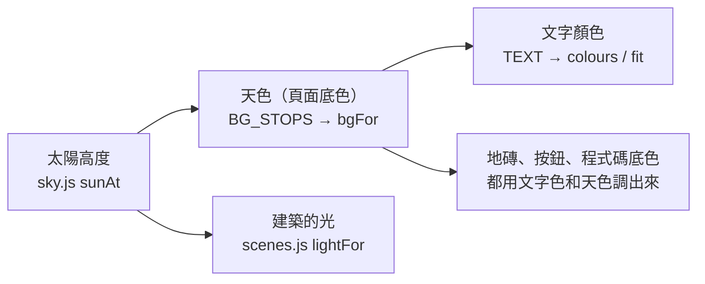
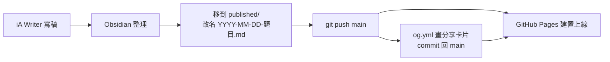
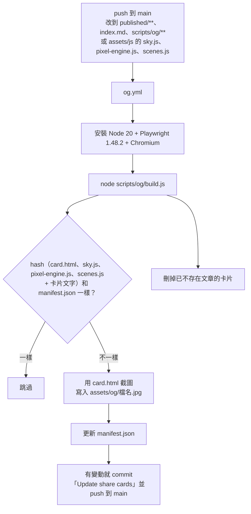
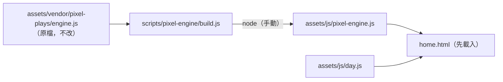
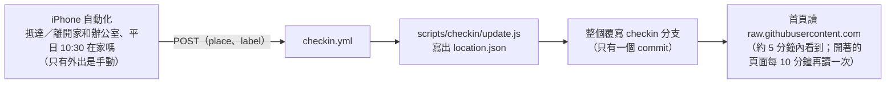

# laiyenju.github.io

Yen Lai 的個人網站：<https://laiyenju.github.io>

- 純 Jekyll，由 GitHub Pages 建置（`main` 分支、根目錄）。沒有主題，沒有外掛，沒有 `Gemfile`。
- 三個自動流程：**GitHub Pages 建置網站**、**GitHub Action 畫分享卡片**（3.2）、**GitHub Action 記錄打卡**（3.5）。
- 兩個手動步驟：
  - 改了 pixel 引擎（`assets/vendor/pixel-plays/engine.js`）或 `scripts/pixel-engine/build.js`，要重新產生 `assets/js/pixel-engine.js`（3.3）。
  - 改了天色（`assets/js/sky.js` 的 `BG_STOPS`、`TEXT`、`colours`），要重畫 README 的天色圖：`node scripts/sky/draw.js`（2.5.1）。

| 章節 | 內容 |
|---|---|
| 1 | 每個檔案在做什麼、不能碰的東西 |
| 2 | 可以自己改的設定，和網站的設計規則（2.5） |
| 3 | 寫文章、分享卡片、引擎、預覽、打卡、新建築的流程 |
| 4 | 還沒處理的事 |

---

## 1. 資料夾結構

| 資料夾／檔案 | 處理什麼 |
|---|---|
| `published/` | 已發布的文章。放進這裡就是發布（3.1） |
| `index.md`、`_layouts/home.html` | 首頁：每天一棟 pixel 建築、Timeline、下方的 terminal（notes、works 都在 terminal 裡）。`home.html` 把文章清單和 `_data/` 的資料寫成 JSON 放進頁面，畫面全部由 `assets/js/day.js` 畫出來 |
| `_layouts/default.html` | 文章頁。從首頁打開時整頁放進首頁的閱讀畫面（2.4「閱讀畫面」），從外部連結打開時才自己顯示 |
| `_includes/` | 每頁共用的 `<head>`（`head.html`）、SEO 標籤（`seo.html`）。`head.html` 在 `body` 出現之前就套上天色，從首頁點進來不會先閃白；`theme-boot.html` 再加上夜晚的淺色字和介面語言 |
| `_data/works.yml` | 作品集（2.3） |
| `_data/days.yml` | 去過的地方：首頁的往年今日、Timeline 的每一天（2.3.1） |
| `_data/little.yml` | 小事，在今天的建築旁出現一週（2.3.2） |
| `_config.yml` | 網站資訊、哪些檔案要建置（2.1） |
| `assets/js/sky.js` | 首頁和文章頁共用：所在城市、太陽位置、天色和文字顏色（2.5.1）、頂部翻牌時鐘 |
| `assets/js/day.js`、`assets/css/day.css` | 首頁：Timeline、terminal、版面 |
| `assets/js/scenes.js` | 建築模型 `SCENES`、光線、影子和窗燈。分享卡片也用它 |
| `assets/js/pixel-engine.js` | 產生的檔案（3.3） |
| `assets/js/post.js`、`assets/js/theme.js`、`assets/css/site.css` | 文章頁：圖片排版和放大、註腳、每分鐘跟著天色更新。Markdown 樣式在 `site.css` 的 `.post-prose` |
| `assets/vendor/pixel-plays/`、`scripts/pixel-engine/` | Pixel Plays 引擎原檔（MIT，作者 AmirMushich，`LICENSE` 在同一個資料夾），和把它轉成 `pixel-engine.js` 的程式 |
| `scripts/sky/` | `draw.js` 從 `sky.js` 畫出天色圖 `sky.svg`（2.5.1 的圖） |
| `assets/og/`、`scripts/og/`、`.github/workflows/og.yml` | 分享卡片：圖檔、產生程式、自動執行的 Action（3.2） |
| `.github/workflows/checkin.yml`、`scripts/checkin/`、`checkin` 分支 | 打卡（3.5）和外出那天的建築（3.6） |
| `assets/icons/`、`assets/fonts/`、`assets/images/` | favicon、字型、文章圖片 |
| `notes/`、`works/` | `/notes/`、`/works/` 轉到首頁的 `?view=notes`、`?view=works`，首頁捲到 terminal 並執行 `ls notes`／`ls works` |
| `sitemap.xml`、`robots.txt` | 給搜尋引擎 |
| `CLAUDE.md` | 給 Claude 的工作規則（例如：改檔案時要同時更新 README） |

### 注意事項

| 項目 | 說明 |
|---|---|
| 產生的檔案 | `assets/js/pixel-engine.js`（3.3）和 `scripts/sky/sky.svg`（2.5.1）不要直接改，改來源再重新產生 |
| `assets/og/` | Action 自動產生並 commit，不要手動改或刪 |
| `checkin` 分支 | Action 每次打卡都整個覆寫，只有一個 commit、一個 `location.json`。不要手動改，也不要合併進 `main` |
| 打卡寫進 `main` 的 commit | 外出時在已有模型的地點選「當成今天的建築」，Action 會直接 commit「Today at …（check-in）」到 `main`（改 `_data/days.yml`）。本機改東西前先 `git pull` |
| 草稿 | repo 裡目前沒有草稿。要放進 repo，就放在根目錄，檔名結尾用 `.draft.md`，不會上線 |
| 不會上線的檔案 | 根目錄的 `*.draft.md`、`README.md`、`CLAUDE.md`、`scripts/`、`assets/vendor/`、`assets/og/manifest.json`（`_config.yml` 的 `exclude`）。新增根目錄的檔案時，確認要不要加進去 |
| 文章網址 | `published/2026-10-29-題目.md` → `/published/2026-10-29-題目.html`。改檔名會改網址，舊連結會失效 |
| 首頁網址 | 分享這些網址會直接打開那個畫面：`#timeline`；`#day-YYYY-MM-DD`（Timeline 停在那天，同一天第二棟以後加 `-2`、`-3`）；`#past-YYYY-MM-DD`（首頁換成那天的建築，標題上方有一行強調色的「幾年前・日期」，`day.css` 的 `.past-tag`；頂部按鈕寫 Today，點了回到今天；點建築打開 Timeline 的那一天）；`#work-<slug>`；`#note-<檔名>`（例如 `#note-2026-10-29-markdown-styles`） |

---

## 2. 可以調整的設定

只列出要自己動手改的設定。字數、sitemap、分享卡片會自動產生，不用管。

### 2.1 網站資訊：`_config.yml`

| 設定 | 預設 | 說明 |
|---|---|---|
| `title` | `Yen Lai` | 文章頁標題的後半段（「標題 · Yen Lai」） |
| `description` | 一句英文 + 一句中文 | 首頁的搜尋摘要。英文那句和自我介紹（2.4 的 `BIO`）說同一件事 |
| `url` | `https://laiyenju.github.io` | 換網域時要改 |
| `author.name` | `Yen Lai` | 結構化資料的作者 |
| `author.twitter` | `theYenLai` | X 分享卡片的帳號 |
| `og_image` | `/assets/og/home.jpg` | 文章的卡片還沒產生時，先用這張 |
| `lang` | `zh-Hant` | 頁面語言。單一頁面可以在 front matter 用 `lang` 覆蓋（`index.md` 設成 `en`） |

### 2.2 文章：front matter

| 欄位 | 必填 | 預設 | 說明 |
|---|---|---|---|
| `title` | 是 | — | 標題 |
| `subtitle` | 否 | 無 | 副標題，顯示在標題下方，也是 `ls notes` 清單裡標題下面那一行。不填時清單改用 `description`，也沒有就只顯示標題 |
| `date` | 是 | — | `YYYY-MM-DD`。決定排序和顯示的日期（不看檔名的日期）；`total` 字數只算今年的文章 |
| `description` | 否 | 內文前 120 字 | 搜尋摘要，也是分享卡片上的摘要 |
| `lang` | 否 | `zh-Hant` | 英文文章填 `en`，會改 `<html lang>` 和 `og:locale`。結構化資料的語言固定是 `zh-Hant`（`_includes/seo.html`） |

### 2.3 作品集：`_data/works.yml`

一件作品一筆，terminal 的 `ls works` 依檔案順序列出，點了打開那件作品的頁面（`#work-<slug>`）。全部用英文寫（網站介面一律英文，只有文章可以是中文）：

```yaml
- slug: design-lint          # 網址用，英文小寫和 -
  year: "2026"               # 文字，可以寫 "2024–25"
  title: Design Lint
  sub: 一句話說明
  role: Design and build
  problem: 當時的問題
  did: Yen 做了什麼
  result: 結果
  url: https://…             # 選填；只放公開的頁面，私人 repo 不要放
  url_label: open the presentation   # 選填，連結文字，預設 open the portfolio
```

### 2.3.1 去過的地方：`_data/days.yml`

一筆是一天、一棟建築。建築底下每件事只說一次：上面一行強調色的「幾年前・日期」（從 `date` 算，`day.js` 的 `whenTag`）、名稱、地點（Google Maps 連結，`placeFor`），最後一句是 `Yen {did}[ with {with}].[ {extra}]`（`sentenceFor`）。所以 `did` 只寫發生了什麼，不寫時間、地點，也不要再寫一次建築名稱。

| 欄位 | 必填 | 說明 |
|---|---|---|
| `date` | 是 | `"YYYY-MM-DD"`，要加引號。同一天可以有好幾筆，網址依順序是 `#day-2019-01-26`、`#day-2019-01-26-2`… |
| `scene` | 是 | 建築模型的名字，要先在 `assets/js/scenes.js` 的 `SCENES` 裡有。目前有：`studio`（工作地點：富邦遼寧大樓）、`home`（家）、`itsukushima`、`naoshima`、`grandcentral`、`unitednations`、`google`、`highline`、`whitney`、`nyt`、`capitol`、`whitehouse`、`washington`、`lincoln`、`mbc`、`hongik`、`nanshan`（微風南山）。新模型見 3.6 |
| `name` | 是 | 英文名稱 |
| `zh` | 是 | 中文名稱。不要中文時改寫 `no_zh: true` |
| `place` | 是 | 城市或地區，例如 `Sangam, Seoul`，會變成 Google Maps 連結 |
| `did` | 是 | Yen 做了什麼，小寫開頭、不加句號 |
| `with` | 否 | 同行者，一個人或一串 `[Mei, Ken]` |
| `extra` | 否 | 補充一句 |
| `map` | 否 | Google Maps 搜尋文字，預設 `name, place` |
| `country` | 否 | 預設 `Japan`。Timeline 的國家數由它算 |
| `coords` | 否 | `[緯度, 經度]`，例如 `[40.7527, -73.9772]`。那天的筆記，分享卡片上會印出來；外出打卡也靠它認出這個地點（150 m 內，3.6），沒有 `coords` 的地點認不出來 |

缺必填欄位、沒有中文名、或模型不存在時，那一筆不會出現，瀏覽器的 console 會列出缺了什麼。

### 2.3.2 小事：`_data/little.yml`

```yaml
- date: "2026-11-02"
  kind: shiba               # 模型畫得出來的：shiba
  text: Yen met a Shiba Inu on a walk this week.
```

從 `date` 起七天內，今天的建築旁會出現這個角色，句子接在自我介紹後面。

### 2.4 首頁內容

| 設定 | 位置 | 預設 | 一起改／注意 |
|---|---|---|---|
| 瀏覽器分頁標題 | `index.md` 的 `title` | `hey, I'm Yen` | |
| 自我介紹 | `assets/js/day.js` 的 `BIO` | `Yen decides what gets built, then builds some of it. Writes about how those decisions get made.` | 今天的建築底下用它；`whoami` 把開頭的 Yen 換成「Yen Lai, product manager,」。一起改：首頁分享卡片文字（`scripts/og/build.js`，第一人稱「I decide…」）、`_config.yml` 的 `description`、`_includes/seo.html` 的 `jobTitle` |
| 社群連結 | `assets/js/day.js` 的 `whoami` | github、linkedin、x | 首頁不直接放連結，執行 `whoami` 才看得到。一起改：`_includes/seo.html` 的 `sameAs`、`_config.yml` 的 `author.twitter` |
| 所在城市 | `assets/js/sky.js` 的 `CITY` | 台北（緯度、經度、時區 +8） | 決定頂部時間、天色、影子方向。出國時只要改這裡 |
| 今天的建築 | `assets/js/day.js` 的 `todayPlace`、`todayScene`、`OFFICE_HOURS`；假日在 `assets/js/scenes.js` 的 `HOLIDAYS` | 依序判斷，見下面「今天的建築」 | 分享卡片不看打卡，只照週末和 `HOLIDAYS` |
| 「Where is Yen now」的作息 | `assets/js/day.js` 的 `WEEKDAY`、`RESTDAY`、`CHECKIN_FRESH`、`TRANSIT_FRESH` | 見下面「Where is Yen now」 | |
| terminal | `assets/js/day.js` 的 `CHIPS`、`COMMANDS`、`placeBar`、`run`；樣式在 `assets/css/day.css` 的 `.cmdbar`、`.term` | 按鈕：`❯`、About Yen、Notes、Work、Where's Yen、Clear | 見下面「terminal」 |

**今天的建築**：建築是「今天在哪裡過」，「現在在哪」看 Where's Yen。依序判斷：

0. `_data/days.yml` 有今天的日期 → 那棟建築和它的名稱、地點、句子（同一天有好幾筆時用最後一筆；隔天起出現在 Timeline）。
1. 今天在辦公室打過卡 → 辦公室（週末補班也是）。
2. 週末和 `HOLIDAYS`（元旦、228、兒童節、勞動節、教師節、國慶、光復節、行憲紀念日）→ 家。
3. 平日在上班時間（09:00–18:30，`OFFICE_HOURS`）打過「家」→ 家（請假或在家工作）。
4. 其他平日 → 辦公室，晚上回家打卡不會變成家。

農曆假日、請假、補班都不用改程式：平日 10:30 的自動化「打卡：在家嗎」看到手機在家，就打一次「家」；所以休假日在 10:30 之前會先顯示辦公室（3.5 步驟 5）。

**Where is Yen now**：

- 6 小時內的打卡優先（`CHECKIN_FRESH`），說「Yen is {label}, Taipei. Checked in at HH:MM.」。
- 離開家、離開辦公室這種在路上的打卡只算 90 分鐘（`TRANSIT_FRESH`），漏了抵達也不會整晚說在路上。今天是辦公室日時，離開家說「on the way to the office」。
- 沒有有效的打卡才用作息表。平日：00–07 asleep、07–09 on the way to the office、09–12 at the office、12–13:30 lunch、13:30–18:30 at the office、18:30–19:30 on the way home、之後 at home。今天是家的日子就用假日那張表（`RESTDAY`）。

**terminal**：

- 整個首頁只有這一排按鈕，和頂部的按鈕同一種樣子（2.5.3「按鈕」）。底下是一條天色的帶子、往上淡出，捲過去的內容不會撞到字。只在 Timeline、作品頁、文章打開時隱藏。
- 位置：寬螢幕（≥ 900px）一開始在今天的說明下面、置中（`_layouts/home.html` 的 `#barSlot`，按鈕移走時仍留著空間，版面不跳）；往下捲到 terminal 時滑進 terminal、貼在輸入框下面（輸出很長時貼在畫面底部），捲回去再滑回來；滑進去後 `❯` 和輸入框的 `❯` 對齊（`.term .cmdbar .arrow`）。手機：一直固定在畫面底部。放不下時可以左右滑，右邊淡出提示。
- 一開始是收起來的：只有這排按鈕，沒有輸入框，首頁不能往下捲進 terminal（`day.css` 的 `.term:not(.on)`）。點了按鈕、`❯` 或按 `/` 才打開（`openTerm`）。
- 點了分三拍：先把這一行捲到日期卡片正下方、停穩；再一個字一個字打出指令、停一下像按了 Enter；最後輸出一列一列淡入。打字和輸出時，輸入框和按鈕先隱藏，畫面上一次只有一件事（`run`、`focusLine`、`reveal`，`body.term-busy`）。頁面不夠長時 terminal 下方自動留白。
- 清單裡點一列（`open works/…`、`open notes/…`）立刻打開，不打字。
- `clear` 清空 terminal、捲回頂端、再收起來（`clearTerm`）。從其他畫面回到首頁（離開 Timeline、作品頁、文章，或離開往年今日）時一律清空；只有回到清單（`← Work`、`← Notes` 或瀏覽器上一頁）會保留清單。
- 系統設定「減少動態效果」時直接顯示，不打字。

**閱讀畫面**（作品和文章共用一套，沒有另外的程式）：

- 清單裡點一篇，在首頁的閱讀畫面打開（`#note-<檔名>`、`#work-<slug>`，`day.js` 的 `openNote`、`openWork`）。同樣的卡片和按鈕（`← Notes`／`← Work`、Home）。
- 文章的內容是文章頁本身，整頁放在閱讀畫面裡（`iframe`），所以文章的樣式只有 `site.css` 一份。放在裡面時（`html.post-embed`）不顯示自己的卡片；文章裡的連結開在整個視窗，Esc 和放大圖片會通知首頁（`post.js` 的 `EMBED`、`tellHome`）。
- 回清單（`backToList`）：從清單打開的，就關掉、把清單捲回日期卡片下方、剛讀的那一列反白再退掉；從連結打開的，就執行一次 `ls notes`／`ls works`。Home 和 Esc 回到乾淨的首頁。
- 清單的列也是連結：⌘／Ctrl 點或中鍵點，在新分頁打開文章頁本身。
- 從外部連結直接打開文章頁時，框架一樣：頂部日期卡片（左邊 `← Notes` 連到 `/?view=notes`，右邊 Home），下面是靠左的標題，標題一個字一個字打出來，文末是 `(END)`。

### 2.5 外觀

#### 2.5.1 天色：整個網站只有一條顏色規則

網站沒有日夜切換，也沒有不同時段的版本。**只有一個輸入：所在城市（`CITY`）現在的太陽高度。** 其他顏色都從它算出來，分三層：




上面的圖由 `node scripts/sky/draw.js` 從 `sky.js` 畫出來。改了 `BG_STOPS`、`TEXT` 或 `colours` 後要重畫，和 `sky.js` 一起 commit。

**第一層：天色**（`assets/js/sky.js` 的 `BG_STOPS`）。七個顏色點，兩點之間依太陽高度連續漸變：

| 太陽高度 | 顏色 | 名稱 |
|---|---|---|
| −18° 以下 | `#151926` | 深夜 |
| −9° | `#282e4a` | 夜藍 |
| −4° | `#3e3560` | 黃昏紫 |
| 0° | `#dec8be` | 日出日落 |
| 5° | `#f4e6d4` | 晨光 |
| 14° | `#f7f3ea` | 白天 |
| 28° 以上 | `#f8f8f5` | 正午 |

- 天色在約 −2° 從暗換成亮（`colours` 的 `dark`：亮度 < 0.55）。台北的太陽從 −4° 走到 0° 只要約 20 分鐘，所以紫色和暖粉色出現的時間很短。
- 介於中間的顏色，放淺色字或深色字都不好讀，所以 `colours` 會把它推開：偏暗的再壓暗、偏亮的再提亮（圖上「設定 → 實際」兩個色號不同的就是被推過的）。**新的顏色點要選夠暗或夠亮的**，才會照設計顯示；黃昏紫 `#3e3560` 就是這樣選的。

**第二層：文字**（`sky.js` 的 `TEXT`、`fit`）。只有兩組設計好的顏色：天亮時一組（`TEXT.day`），天暗時一組（`TEXT.night`），各有內文（ink）、副標（soft）、日期與提示（faint）、強調色（accent）。

- 每種文字先用 `TEXT` 的顏色；在這個天色上讀不清楚時，才往更深或更淺移一點，夠讀就停。最低對比：內文 7、副標 5.6、日期與提示 5、強調色 4.8（WCAG 標準是 4.5）。
- 強調色：天亮時 `#b5531e`（朱）、天暗時 `#f0a46a`（橘）。首頁和文章頁共用（文章的 `--accent`、`--shu`、內文標題都用它）。分享卡片在 `scripts/og/card.html`，要一起改。
- 其他顏色都從文字色和天色調出來，所以任何時間都讀得清楚、不用另外調：卡片和按鈕的底色（`sheet`）、按鈕（2.5.3）、地磚（2.5.2）、程式碼區塊的底色（`site.css` 的 `--washi`：天色加 7% 文字色）。
- 文章頁：`head.html`、`theme-boot.html` 在第一個畫面前套上，`theme.js` 每分鐘更新。`site.css` 裡的 `#fafaf7`、`#0d0f12` 只在 `sky.js` 沒載入時用。固定不變的只有 `_includes/seo.html` 的 `theme-color`（瀏覽器網址列，跟著系統設定用 `#fafaf7`／`#0d0f12`）和分享卡片（`#fafaf7`）。

**第三層：建築的光**（`assets/js/scenes.js` 的 `lightFor`）。每棟建築只有一套白天的顏色，晚上的樣子全部由光算出來：

| 光 | 什麼時候 | 做法 |
|---|---|---|
| 天暗時整體變暗、偏藍 | 太陽 4° 以下漸漸開始，−10° 最暗 | `kr`、`kg`、`kb` 三個色版相乘；日出日落前後偏暖（`warm`） |
| 保留飽和度 | 跟著變暗一起 | `sat`：光越暗，飽和度往上補一點，顏色不會變灰、變髒 |
| 外框變亮 | 太陽 −2° 以下，−8° 最亮 | `rim`：建築碰到天空或地面的那一圈像素，往月光色 `MOON` 移（最多一半）。引擎原本把這圈調暗，在暗天空上會看不見 |
| 窗戶亮燈 | 太陽 3° 以下 | `api.emissive`；辦公大樓約兩成樓層不亮 |
| 打燈 | 太陽 3° 以下 | `api.emissive(…, 'flood')`：紀念建築、鳥居、家的室內，保留白天的顏色、偏暖 |
| 影子方向 | 太陽 4° 以上 | 跟著太陽的方位（`sx`、`sy`） |

新模型只要用白天的顏色畫，晚上不用另外做；要發光的部分用 `api.emissive`，不該發光的面不要和發光的部分用同一個顏色。

#### 2.5.2 建築

| 設定 | 位置 | 預設／規則 |
|---|---|---|
| 建築大小 | `assets/js/day.js` 的 `sizeStage`、`homeScale`（`fitCanvas`）、`tlScale`（`fitTl`）、`TL_K`、`wholePixels` | 首頁的建築一律盡量大：框裡放到 `* .97`，最多 4.4 倍。畫素取整數倍螢幕像素（`wholePixels`，不會因此變小超過兩成）。細節見下面 |
| 家 | `assets/js/scenes.js` 的 `SCENES.home`、`bookWall`、`glassPane`、`HOME_TREES`、`NOTE_BOOKS`、`PLAIN_BOOKS`、`HOME_WALK` | 見下面「家」 |
| 建築下面的地磚 | `assets/js/day.js` 的 `PLATE`、`plateFor`、`placePlate`、`suckPlate`、`unrollPlate`；說明上方的空間在 `day.css` 的 `.caption` 的 `padding-top`（24px） | 見下面「地磚」 |
| 首頁才會動的細節 | `assets/js/scenes.js` 的 `e.moving`（`flag`、`usFlag`、`krFlag`、`birds`、`ripples`、`beacon`） | 旗子飄、樹和植物搖、鳥飛、水波、噴泉、屋頂紅燈閃。只在首頁動，Timeline 裡同一棟是靜止的，用來分辨現在在哪一頁。新模型在 `build` 裡用 `e.moving((e, t) => …)`；`t` 是 `null` 時畫靜止的樣子。「減少動態效果」時不動 |
| 建築的邊緣 | `assets/js/scenes.js` 的 `getWorld`、`cleanShadow` | 沒有地面的模型（`bare`）不畫地面的陰暗邊（`bakeOcclusion`），影子邊緣整理成一條乾淨的線，四周不會有像去背沒去乾淨的灰點。晚上的亮外框見 2.5.1 |

**建築大小**：

- 寬螢幕：和手機一樣上下排：建築、說明、按鈕（置中）。建築框最寬 900px，高度是畫面扣掉日期卡片、說明和下方 32px 剩下的（260–760px），建築和說明在卡片下方的空間裡上下置中。
- 手機：建築框是畫面高度的六成，但不超過畫面寬度的 1.25 倍；不會因為有往年縮圖或說明比較長而縮小（放不下的說明往下捲）。還有空間時平均分到上下，建築和說明整組置中。沒有往年今日時，縮圖那一列收起來（`.tools:has(.thumbs.none)`）。
- Timeline：是首頁同一棟建築的 `TL_K`（0.85）倍，框也縮成 0.85 倍、從同一個頂端開始（`day.css` 的 `--tl-k`），所以進 Timeline 時建築往上稍微縮小。取整數後若不在首頁大小的 75%–90% 之間，就直接用 0.85 倍。

**家**（`SCENES.home`）：

- 兩層的鋁板盒子，首頁看得到的兩面（+x、+y）剖開，看得到室內：左後牆是兩層高的書牆，右後方 2 樓是閣樓（閱讀角），1 樓是長桌（工作兼吃飯）、廚房和沙發，書牆上方是玻璃天窗。晚上室內保持亮著（`'flood'`），吊燈、立燈和筆電螢幕發光。
- 書牆一開始放滿灰色的書、盆栽、黑膠和花瓶。每篇筆記（`published/` 的文章數）把一本灰書換成彩色的書，從最上層的左邊開始（顏色依序用 `NOTE_BOOKS`，灰書的顏色在 `PLAIN_BOOKS`）。格數由 `bookWall` 的 `rows`（8）和每格寬約 0.72 決定，最上層大約放得下 50 本。
- 一隻柴犬沿著 `HOME_WALK` 繞一圈（書牆前、走出人行道、再從長桌旁走回來）；一隻黑白貓坐在沙發椅背上，尾巴會掃、偶爾轉頭，每 24 秒沿著椅背走到另一頭（`cat`、`catWalking`、`catOnSofa`）。Timeline 的靜止版沒有牠們。
- `home` 有自己的人行道和草地，不加地磚。

**地磚**：

- 本身沒有地面的模型（`bare`，目前除了 `home` 都是）站在一塊淡淡的等距地磚上。大小照建築貼地的範圍（`plateFor` 只算碰到地面的像素，拱門下方、屋頂、旗子不算），四周多 0.6 格，每格約 1 單位，前面兩側有一點厚度。懸空的部分下面要有碰地的東西，地磚才鋪得到。
- 顏色是頁面的文字色、很淡（`PLATE` 的 `top`、`line`、`right`、`left` 是透明度），所以跟著天色變。影子畫在建築的圖上，落在地磚上。
- 進 Timeline 時，地磚往建築的中心收進去、越收越快，像被吸塵器吸進去（`suckPlate`，約 0.38 秒）；回首頁時，等建築落定後再從中心鋪開（`unrollPlate`，0.42 秒）。Timeline 裡沒有地磚。「減少動態效果」時直接出現、消失。

#### 2.5.3 介面

| 設定 | 位置 | 預設／規則 |
|---|---|---|
| 網頁字型 | Quattro：`assets/fonts/quattro/`（文章頁在 `site.css`、首頁在 `day.css` 開頭載入）。JetBrains Mono、Noto Sans TC：Google Fonts（文章頁 `_includes/head.html`、首頁 `_layouts/home.html`） | 一般文字（首頁說明、Timeline、作品頁、文章）：iA Writer Quattro → Noto Sans TC。terminal、日期、按鈕：JetBrains Mono → Noto Sans TC。中文一律用 Noto Sans TC。Quattro 只有 400、700，所以 Noto Sans TC 也只載入 400、700，中英文才一樣粗。中英文之間的小空隙用 `text-autospace`（支援的瀏覽器才有） |
| 首頁字級 | `assets/css/day.css` 的 `.caption .name`、`.caption .note`、`.when b` | 今天的標題和說明都是 21px（行高 1.5），標題只是粗體，兩者之間多 10px |
| 日期卡片 | 首頁 `_layouts/home.html` 的 `.top-row`、`day.css` 的 `.top`；文章頁 `_layouts/default.html` 的 `.post-row`、`site.css` 的 `.post-top` | 見下面「日期卡片」。`--card-top`、`--card-title`、`--card-sub` 在 `day.css` 和 `site.css` 各有一份，要一起改 |
| 倒轉今天 | `assets/js/day.js` 的 rewind 區段和建築的手勢（`stage` 的 `pointer*`、`rwStart`、`rwMove`、`rwEnd`；`SUN_MARKS`、`SNAP`、`PULL`、`GAIN_MAX`、`FLING_MAX`、`IDLE_BACK`、`DL`、`paintDayline`）；樣式在 `day.css` 的 `.when.is-rewound`、`.when.hint`、`.dayline`；倒著翻的數字在 `sky.js` 的 `rollClock`（`back`） | 吸附：黎明、日出、日落、黃昏，前後 8 分鐘，多拉 10 px 才離開；拖動 1–8 分鐘／px；放著 60 秒回到現在。見下面「倒轉今天」 |
| 按鈕 | `assets/css/day.css` 的 `.top-btn, .cmdbar button`、`--press-soft`；文章頁 `site.css` 的 `.post-btn` | 見下面「按鈕」 |
| 轉場 | `day.js` 的 `lightRow`、`reveal`、`openTl`／`leaveTl`（`tl-in`）；文章在 `_layouts/default.html` 的開頭和 `site.css` 的 `post-rise` | 見下面「轉場」 |
| Timeline 的動畫 | `assets/js/day.js` 的 `buildUp`（一磚一磚，磚塊 4×3 像素）、`dissolve`、`MOVE` | 蓋起來 0.9 秒、溶解 0.2 秒、首頁和 Timeline 之間移動 0.48 秒。「減少動態效果」時直接跳到結果 |
| Timeline 的尺標 | `assets/js/day.js` 的 `renderRuler`、`renderRow`、`layoutRow`、`ROW`；樣式在 `day.css` 的 `.ruler-track`、`.tl-row` | 見下面「Timeline」 |

**日期卡片**：

- 頂部一行，像 terminal 的標題列，置中、最寬 440px（手機上左右各留 20px，和內文對齊）。左邊回清單（`← Work`／`← Notes`，只在作品和文章），中間是時間（沒有框，只是字），右邊的按鈕寫現在所在的畫面：今天的首頁是 Today（點了打開 Timeline）、Timeline 裡是 Timeline（點了回到今天）、過去某天是 Today（點了回到今天）、倒轉今天時是 Now（點了回到現在）、作品和文章是 Home（只有圖示）。切換在 `day.js` 的 `ctaFor`。
- 底下是一條天色的帶子、往下淡出，捲動時內容不會撞到字。
- 離頂端 `--card-top`：手機 12px；寬螢幕（≥ 900px）是畫面高度的 9%（28–96px）。字級：上面一行 `--card-title`（15px）、下面一行 `--card-sub`（12px），每一頁都一樣。
- 上面是現在的時間，到秒（`HH:MM:SS`），下面是所在城市今天的星期（`Fri`；首頁 `day.js` 的 `todayWd`，文章頁 `post.js` 的 `tick`）。每個數字像翻牌一樣往上捲到下一個（`sky.js` 的 `rollClock`，首頁由 `day.js` 的 `secondTick`、文章頁由 `post.js` 的 `tick` 每秒呼叫；樣式在 `day.css`、`site.css` 的 `.roll`）。
- Timeline 裡上面一行是那天的日期（數字像轉盤一樣轉到那天），下面是「幾年前」（`Seven years ago`；今年稍早寫 `This year`，今天寫 `Today`）。進出 Timeline 時，時間和日期疊在同一個位置交叉淡入淡出（淡出的稍微變模糊；淡入的日期直接停在那天）；換一天時下面一行同樣交叉淡入淡出（`day.js` 的 `dialTo`、`day.css` 的 `.when .face`）。停在過去某一天時用強調色（`.when.is-past-day`）。
- 「減少動態效果」時直接換數字。

**倒轉今天**（只在今天的首頁）：

- 在**建築上**左右拖（手機用手指滑；觸控板用兩指左右滑），往左是更早。建築是畫面上最大的東西，手指有空間，而且影子就在手指下面轉；頂部的時間上也可以拖。點一下建築還是打開 Timeline，上下滑留給頁面捲動。往年今日在今天的首頁改成點縮圖或按 `←` `→` 切換；過去某天的首頁（`#past-`）沒有倒轉，那裡在建築上左右滑還是切換年份（`day.js` 的 `drag.mode`：`time`／`h`）。
- 範圍是今天 00:00 到現在，未來不能看。天色、文字色、建築的光和影子都跟著那個時刻變（`minuteMs` 改用拖到的分鐘；真正的時間 `state.minute` 不變，Where's Yen 還是說現在）。
- 拖的時候：時間每個數字往回翻（`rollClock` 的 `back`），時間和下面一行用強調色（`.is-rewound`），停在吸附點時下面一行加上名稱（`Sat · dusk`）。
- **太陽的軌跡**（`paintDayline`、`placeDayline`）：拖動時出現在**建築正中間**，不在頂部。用手指在建築上拖時，放在手指上方 44px（`DL.LIFT`；手指離建築頂端太近時改放下方），因為手指只會擋住下面、不會擋住上面；從時間、鍵盤、觸控板操作時，放在建築的垂直中央。它是一條半透明的天色玻璃（`day.css` 的 `.dayline`），四邊淡出，沒有框。內容和建築一樣是整數倍像素（手機 2 倍、寬螢幕 3 倍）：地平線、今天太陽走過的弧線（現在之後是虛線）、強調色的太陽和往下的細線；晚上太陽在地平線下，只剩一小段暗的短線。最下面一條是那一刻的天色（`BG_STOPS` 原本的顏色，看得到黃昏的紫色），現在之後蓋淡。太陽上方跟著它寫出那一刻的時間（`17:24 · dusk`），眼睛不用離開畫面中間；日出、日落的時間寫在天色條下面。放開後淡出。
- **日晷**：建築的影子跟著太陽轉。拖動時顏色每一格畫面都換；影子重畫一次約 80ms，所以最多每 0.18 秒重畫一次（`swing`）。
- **手感**：慢慢拖是 1 px 1 分鐘，拖得越快每 px 越多分鐘，最多 8 分鐘（`GAIN_MAX`）。黎明、日出、日落、黃昏（太陽 −4°、0°）前後 8 分鐘（`SNAP`）會停住，要多拉 10 px（`PULL`）才離開；手機會輕震一下。黃昏的紫色只有約 20 分鐘，所以要幫訪客停住。放開時還在動，時間會繼續滑、慢慢停下來，經過吸附點附近時被吸住（`fling`）。
- 頁面底色平常 1.2 秒淡入，拖的時候縮短成 0.12 秒（`body.rewinding`），跟得上手指。
- **回到現在**：點右邊的 Now，或放著 60 秒（`IDLE_BACK`），數字往前翻回現在。離開首頁（Timeline、往年今日、作品、文章）時直接回到現在，不翻。
- **讓人發現**：第一次來的訪客，在頁面停好約 2.4 秒後，時間自己往回翻 40 分鐘、太陽軌跡出現，再翻回現在，只播一次（記在 `localStorage` 的 `teased`；訪客先動了、設定減少動態效果、或瀏覽器不能記錄時都不播）。滑鼠指到時游標是左右箭頭。還沒倒轉過的訪客，時間左邊有一個淡淡的 `‹`，第一次倒轉後就不再出現（`rewound`）。
- **鍵盤**：Tab 移到時間上，`←` `→` 每次 15 分鐘（加 Shift 是 1 小時），Home 到 00:00，End 回到現在。只有在今天的首頁，時間才是滑桿（`role="slider"`，`syncCardRole`），其他畫面不能 Tab 到它。
- 「減少動態效果」時：不播第一次的提示、放開時不會繼續滑、回到現在不翻，直接到。

**按鈕**：全站只有一種，從 terminal 清單的選取（`.ls .lit`）來，只用文字色和天色，所以不用為不同時間另外調。

- 等寬字（13px），平常沒有框、沒有底色；滑鼠指到時後面有一塊很淡的文字色（7%，只在有滑鼠的裝置上）；按下去整塊反白（文字色底、天色字、直角），左右比字多出 10px；用鍵盤移到時是一圈強調色的直角框。`❯` 用強調色。
- 頂部的按鈕、terminal 那排按鈕、清單的列都是這個樣子。只能看的東西（時間）也沒有框。
- 文章頁的按鈕是連結（`<a>`），`.post-btn` 另外蓋掉手機點擊的灰色閃光和連結的底線、變色。

**轉場**：一套動作。

- terminal 的輸出一列一列往上浮現。選中的列像 terminal 的選取：整列反白（文字色底、頁面底色字），左右各多出 10px，沒有圓角；滑鼠指到的列先有一層很淡的同色塊（`day.css` 的 `.ls .lit`、`.ls a:not(.lit):hover`）。清單點一列：那一列先標上 0.11 秒再打開。
- 作品和文章：直接切過去，內容由上往下約 0.25 秒浮現，不打字。回到清單：清單捲回日期卡片下方，剛讀的那一列先反白再慢慢退掉。
- 進出 Timeline：今天的文字先退開，Timeline 的文字才出現，離開時反過來，兩者不重疊。
- 首頁和文章頁都在第一個畫面前就套上天色，不會先白再變色。
- 「減少動態效果」時都直接切換。

**Timeline**：

- 尺標每棟建築一格、等距排列（同一天的建築間距減半），最舊的在左邊，不標年份（頂部日期已經有）。點一格跳過去；手指按住左右滑可以快速切換（滑動時不播動畫，放開就停在那棟）；鍵盤可用左右方向鍵。
- 手機：尺標固定在畫面底部。寬螢幕（≥ 900px）：尺標緊接在建築名稱下面；其他天的建築依時間排在選中那棟的左右兩邊，比較小、灰色、半透明（多的超出螢幕兩側），點一棟就切過去；選中的建築比較寬時，兩旁的會再往外讓開，不會重疊。手機不顯示兩旁的建築。

#### 2.5.4 文章頁

| 設定 | 位置 | 預設 | 注意 |
|---|---|---|---|
| 圖片排版 | `assets/css/site.css` 的 `.post-fig`、`.post-gallery`；`assets/js/post.js` 的 `buildFigures` | 單張和內文同寬；直式圖片（高 > 寬 × 1.1）寬度 `80%`；同一段有兩張以上時並排，總寬 `960px`，間距 `20px`；手機（≤ 640px）上下排列 | 並排的圖片會伸到側欄，`post.js` 會把側欄註腳往下推 |
| 圖片放大 | `assets/css/site.css` 的 `.lb`；`assets/js/post.js` 的 `buildLightbox` | 寬螢幕：左欄 `320px` 放關閉、圖說、上一張／張數／下一張，細線隔開右邊的圖片；窄螢幕（≤ 767px）：上面關閉和箭頭，下面張數和圖說 | Esc 關閉、左右鍵切換；手機左右滑；點圖片關閉。一篇的圖片依序循環 |
| 註腳放側欄的最小寬度 | `assets/js/post.js` 的 `RAIL_MIN` | `1088`（px） | 較窄時放文末。要和 `site.css` 的文章欄寬（680px）一起算 |

### 2.6 介面語言

首頁全部是英文，只有文章標題和地點的中文名（`zh`）是中文。文章頁沒有設定可以改：瀏覽器第一語言是中文就顯示中文，其他顯示英文。文章頁新增介面文字時，兩種語言都要寫：

| 位置 | 寫法 |
|---|---|
| HTML | `<span class="i-en">…</span><span class="i-zh">…</span>` |
| JS | `t("English", "中文")` |
| `aria-label`／`title` | 預設寫英文，中文寫在 `data-label-zh`／`data-title-zh` |

---

## 3. 流程

### 3.1 寫作與發布



1. 草稿可以不放進 repo；要放的話見第 1 節「注意事項」的「草稿」。
2. 發布 = 把檔案移進 `published/`，檔名用 `YYYY-MM-DD-題目.md`。
3. 寫好 front matter（見 2.2）。
4. `git push` 到 `main`，其他都是自動的。

內文標題（`##` 到 `######`）後面接一般段落時，會併進那一段的開頭，用強調色顯示（`assets/js/post.js` 的 `runInHeadings`）；後面接清單、表格、圖片或另一個標題時，自己一行。標題不要寫得太長，讀起來才像段落的開頭。

圖片的寫法：``。引號裡的文字是圖說，不寫就沒有圖說。一張圖自己一段；要並排就把兩張以上的圖片放在同一段（連續幾行，中間不空行）。

notes 清單顯示的是 `title`；從清單點開文章時，`cat` 指令和分享卡片上的檔名會去掉日期（`markdown-styles.md`）。

### 3.2 分享卡片（自動）



卡片是一張明信片（`scripts/og/card.html`）：

- 左邊是那篇筆記當天的建築，像 Timeline 一樣只有建築、沒有影子，盡量放大，底色是由上往下淡出的暖色天空（網站太陽約 8° 時的顏色）。
- 建築的選法：那天在 `_data/days.yml` 有地點就用那個地點，下面寫名稱、城市・國家、經緯度（`coords`）；沒有就照日曆：平日辦公室，週末和 `HOLIDAYS` 是家（卡片不看打卡），下面寫 The office／Home 和 Taipei · Taiwan。地點由 `scripts/og/build.js` 的 `places` 讀 `days.yml`。
- 右邊是郵戳（城市、日期、星期）、`cat notes/<檔名>`、標題、副標題（沒有就用摘要）和寄件地址，沒有郵票。
- 首頁的卡片是辦公室，郵戳不寫日期。

- 改了 `card.html` 或畫建築的程式（`assets/js/sky.js`、`pixel-engine.js`、`scenes.js`），所有卡片都會重畫；`og.yml` 也會因為這些檔案的改動而執行。新文章的卡片產生前，先用 `home.jpg`。
- 也可以在 GitHub → Actions → Share cards → **Run workflow** 手動執行。
- 本機執行：

  ```bash
  npm install --no-save playwright && npx playwright install chromium && node scripts/og/build.js
  ```

### 3.3 pixel 引擎（手動產生）



`build.js` 把原本只畫一個場景的引擎包成 `createPixelEngine(canvas, SCENE)`，讓首頁可以同時有好幾個場景，並加上每個場景的畫布大小、比例和平面旋轉。改了原檔或 `build.js` 之後執行，再把 `pixel-engine.js` 一起 commit：

```bash
node scripts/pixel-engine/build.js
```

新增建築模型不用重新產生：模型寫在 `assets/js/scenes.js` 的 `SCENES`。

### 3.4 本機預覽

```bash
jekyll serve
```

首頁的資料是 Jekyll 寫進頁面的，所以要用 `jekyll serve` 看，不能直接打開 HTML 檔。

輸出在 `_site/`（已在 `.gitignore`）。

### 3.5 打卡（自動）



`location.json` 只有文字，沒有座標：

| 欄位 | 內容 |
|---|---|
| `place` | `home`、`office`、`out`、`left_home`（離開家）、`left_office`（離開辦公室） |
| `label` | 首頁說的話，接在「Yen is」後面，例如 `at a café in Daan`。沒填就用 `at home`、`at the office`、`out somewhere in the city`、`heading out`、`on the way home`（`update.js` 的 `LABELS`，最多 60 字） |
| `at` | 打卡時間（UTC） |
| `office_at` | 最近一次在辦公室打卡的時間，每次打卡都會保留。首頁用它判斷今天是不是辦公室（見 2.4） |
| `homes` | 24 小時內所有「家」的打卡時間。平日有一次落在上班時間，首頁就把今天當成休假（見 2.4） |

**第一次設定（只做一次，約 15 分鐘）**

先做「家」、測試成功後再複製成「辦公室」，因為測試時會真的打一次卡，打辦公室會讓今天變成辦公室日。

**步驟 1：在電腦上建立 token**（打卡用的鑰匙，只能觸發打卡，不能改網站）

1. 打開 <https://github.com/settings/personal-access-tokens/new>
2. Token name：`website check-in`
3. Expiration：選最長的（1 年）
4. Repository access：**Only select repositories** → 選 `laiyenju.github.io`
5. Permissions：**Add permissions** → **Actions** → Access 改成 **Read and write**（Metadata 會自動加上唯讀，不用管）
6. **Generate token**，複製 `github_pat_…` 開頭的那串字。只會顯示這一次，先存進密碼管理器，再傳到手機

**步驟 2：在 iPhone 建立捷徑「打卡：家」**（捷徑 App，括號裡是英文介面的名稱）

1. 「捷徑」分頁 → 右上 **＋** → 最上面的名稱改成 `打卡：家`
2. 搜尋動作 `URL` → 點 **取得 URL 內容**（Get Contents of URL）
3. 點動作裡藍色的 **URL**，貼上：
   `https://api.github.com/repos/laiyenju/laiyenju.github.io/actions/workflows/checkin.yml/dispatches`
4. 點動作右邊的 **›**（展開），會出現「方法」「標頭」「要求本文」
5. **方法**（Method）：`GET` 改成 `POST`
6. **標頭**（Headers）→ **新增新標頭**（Add new header），加兩個：

   | 鍵 | 值 |
   |---|---|
   | `Authorization` | `Bearer github_pat_…`（Bearer、一個空格、你的 token） |
   | `Accept` | `application/vnd.github+json` |

7. **要求本文**（Request Body）選 **JSON**，然後：
   - **新增新欄位**（Add new field）→ **文字**（Text）→ 鍵 `ref`，值 `main`
   - **新增新欄位** → **辭典**（Dictionary）→ 鍵 `inputs` → 點這一列進去 → **新增新欄位** → **文字** → 鍵 `place`，值 `home` → 左上返回
8. 完成後應該長這樣：

   ```
   取得 URL 內容  https://api.github.com/repos/…/checkin.yml/dispatches
     方法     POST
     標頭     Authorization: Bearer github_pat_…
              Accept: application/vnd.github+json
     要求本文 JSON
              ref: main
              inputs (辭典)
                place: home
   ```

**步驟 3：測試**

1. 在捷徑裡按右下 **▶︎** 執行。沒有跳出任何訊息就是成功（GitHub 成功時不回內容）
2. 到 GitHub → Actions → **Check in**，應該有一筆綠色勾勾
3. 約 5 分鐘後，首頁 terminal 按 **Where's Yen**，會看到 `Yen is at home, Taipei. Checked in at HH:MM.`

跳出一段英文時，看裡面的數字或 message：

| 訊息 | 原因 |
|---|---|
| `Bad credentials`（401） | token 貼錯、過期，或 `Bearer` 後面少了空格 |
| `Resource not accessible`（403） | token 的權限不是 Actions：Read and write |
| `Not Found`（404） | URL 打錯，或 token 沒選 `laiyenju.github.io` |
| `Unprocessable`（422） | 要求本文錯：`ref` 不是 `main`、`place` 不是 `home`／`office`／`out`／`left_home`／`left_office`，或 `inputs` 不是辭典 |

**步驟 4：複製出另外三個打卡捷徑**

長按「打卡：家」→ **複製**（Duplicate）→ 改名稱和 `inputs` 裡的 `place`。都不要執行（會真的打卡）。

| 捷徑 | `place` |
|---|---|
| `打卡：辦公室` | `office` |
| `打卡：離開家` | `left_home` |
| `打卡：離開辦公室` | `left_office` |

**步驟 5：做「打卡：在家嗎」**（平日 10:30 自動執行，整天沒出門的休假日靠它，不用手動）

1. 新捷徑，名稱 `打卡：在家嗎`
2. 加動作 **取得距離**（Get Distance）：從 家的地址（Home）到 **目前位置**（Current Location）。展開後：路線類型（Route Type）**直線**（Direct）、單位 **公里**（Kilometers）。不用另外加「取得目前位置」
3. 加動作 **如果**（If）：**距離**（Distance）**小於**（is less than）`0.5`。會自動出現「否則」（Otherwise）和「結束如果」（End If）
4. 加動作 **執行捷徑**（Run Shortcut）→ 選 **打卡：家**，然後**按住它拖到「如果」和「否則」中間**。放在「結束如果」下面的話，不管在不在家都會打卡
5. 「否則」裡面留空：不在家就什麼都不打。完成後應該長這樣：

   ```
   取得距離  從 Home 到 目前位置（直線、公里）
   如果  距離 小於 0.5
     執行捷徑  打卡：家
   否則
   結束如果
   ```

平日早上在家工作也會變成家，這是對的（那天確實在家）。之後才去公司，抵達辦公室的打卡會把今天改回辦公室。

**步驟 6：設定自動化（五個，全部選「立即執行」）**

一個自動化只能有一個觸發條件，所以是五個分開的自動化，在「自動化」分頁會看到五列。

1. 「自動化」分頁 → 右上 **＋** → **抵達**（Arrive）
2. 位置 → **選擇** → 搜尋家的地址 → 完成；時間選 **任何時間**
3. 選 **立即執行**（Run Immediately）。「執行時通知」可以關掉
4. **下一步** → 選捷徑 **打卡：家** → 完成
5. 照同樣方式做其他四個：

| 觸發 | 捷徑 |
|---|---|
| 抵達 公司 | 打卡：辦公室 |
| 離開（Leave） 家 | 打卡：離開家 |
| 離開 公司 | 打卡：離開辦公室 |
| 特定時間（Time of Day）10:30（要在 `OFFICE_HOURS` 裡面，09:00–18:30），重複選 **每週** 一到五 | 打卡：在家嗎 |

第一次可能會問位置權限，選允許（「在家嗎」要讀目前位置）。

**「打卡：外出」**（唯一要手動按的，例如在咖啡店）：完整做法在 3.6，因為它也決定那天的建築。

**注意**

- 捷徑裡有 token，不要分享這些捷徑。
- token 一年後到期，打卡會失效：做一個新的 token，換掉五個打卡捷徑裡的 `Authorization`（「在家嗎」沒有 token，不用換）。沒換的話，打卡停住，首頁照週末和 `HOLIDAYS` 決定建築、照作息表說 Where's Yen。
- 不用手機時：GitHub（網頁或 App）→ Actions → **Check in** → Run workflow，選 `place`、填 `label`。

### 3.6 外出那天的建築

外出打卡時，捷徑問「要當成今天的建築嗎？」。選「是」，就送出手機的位置（`latlon`），由位置判斷是哪棟，不用記名字：

| 位置 | 結果 |
|---|---|
| 150 m 內有 `days.yml` 裡的地點（看 `coords`） | `scripts/checkin/day.js` 複製那個地點的資料，加上今天和 `did`，commit 到 `main`。幾分鐘後首頁換成那棟 |
| 附近沒有 | 開 issue「新建築：…」（地點名稱、地址、地圖連結）。每晚 21:40 Claude 的排程任務找資料、寫規格、推播通知；在那個對話確認後，Claude 才畫，畫完開 PR |
| 選「否」 | 只改 Where's Yen |

- **怎麼確定是同一棟**：已有模型的，看位置；新地點的，Claude 的規格第一行寫「認定是：名稱、地址、地圖連結」，不對就在確認時改。
- `did` 是建築底下那句話（`Yen {did}.`），英文小寫開頭，不加句號，沒填時是 `spent time here`。
- 位置只用來比對和放進 issue，不會寫進 `location.json`。但 issue 和 Actions 的紀錄是公開的，和 Where's Yen 一樣會讓人知道當下在哪裡。

**捷徑「打卡：外出」怎麼做**

動作名稱用英文介面寫，括號裡是中文介面。在捷徑裡用搜尋找動作；加進來的動作會放在最下面，要按住它拖到要放的位置。

1. 長按「打卡：家」→ **Duplicate**（複製），改名成 `打卡：外出`。
2. 在最上面加 **Ask for Input**（要求輸入），類型 Text，Prompt 寫 `在哪裡？英文，例如 at a café in Daan`。
3. 接著加 **Choose from Menu**（從選單中選擇），Prompt 寫 `要當成今天的建築嗎？`，兩個選項改成 `是`、`否`。
4. 把下面這些動作拖到 `是` 和 `否` 中間，照這個順序：

   | 動作 | 設定 |
   |---|---|
   | **Ask for Input**（要求輸入） | Prompt：`做了什麼？英文，例如 hosted a developer meetup` |
   | **Set Variable**（設定變數） | 名稱 `did`，值選上一步的 **Provided Input**（提供的輸入） |
   | **Get Current Location**（取得目前位置） | 不用設定 |
   | **Text**（文字） | 點 Insert Variable 選 **Current Location**，再點它選 **Latitude**（緯度）；打一個逗號 `,`；再插入一次 **Current Location**，選 **Longitude**（經度）。結果像 `25.0346,121.5667` |
   | **Set Variable** | 名稱 `latlon`，值選上一步的 **Text** |
   | **Text** | 插入 **Current Location** 選 **Name**（名稱），打一個空格，再插入一次選 **Street**（街道） |
   | **Set Variable** | 名稱 `note`，值選上一步的 **Text** |

   `否` 底下什麼都不放。
5. 在 **Get Contents of URL**（取得 URL 內容）的 Request Body，點 `inputs` 那一列進去：
   - `place` 的值改成 `out`。
   - 加一個 Text 欄位，鍵 `label`，值選第 2 步的 **Provided Input**。
   - 再加三個 Text 欄位，鍵是 `latlon`、`did`、`note`，值各選同名的變數。

完成後從上到下是：

```
Ask for Input（在哪裡？）
Choose from Menu（要當成今天的建築嗎？）
  是
    Ask for Input（做了什麼？）→ Set Variable did
    Get Current Location → Text（緯度,經度）→ Set Variable latlon
    Text（名稱 街道）→ Set Variable note
  否
End Menu
Get Contents of URL
  inputs：place = out、label、latlon、did、note
```

做好後不要按 ▶︎ 試，它會真的打卡，選「是」也會真的開 issue。要試就用下面的測試。

**測試**（改了 `checkin.yml` 或 `day.js` 後做一次）：GitHub → Actions → Check in → Run workflow，分支選要測的分支（不要選 `main`，`days.yml` 的 commit 會寫到那個分支），`place` 選 `out`。`latlon` 填 `25.0346,121.5667`（南山）：那個分支多一筆今天（今天已經有就不加）。填 `25.0339,121.5645`（台北 101，沒有模型）：出現一個 issue，測完關掉。兩次都會真的改 Where's Yen，測完再打一次卡。

---

## 4. 待處理

| # | 項目 | 狀況 | 建議 |
|---|------|------|------|
| 1 | `published/2026-03-08-hello.md` | 範例文章，已公開上線、在 sitemap 裡 | 第一篇正式文章上線後刪除 |
| 2 | `published/2026-10-29-markdown-styles.md` + `assets/images/markdown-sample*.svg`（三張） | 樣式測試頁，也公開上線 | 想保留當測試頁，可移到根目錄改成 `.draft.md`（但本機預覽就看不到）；或加 front matter `sitemap: false`，並在 `sitemap.xml`、首頁 notes 清單加條件排除 |
