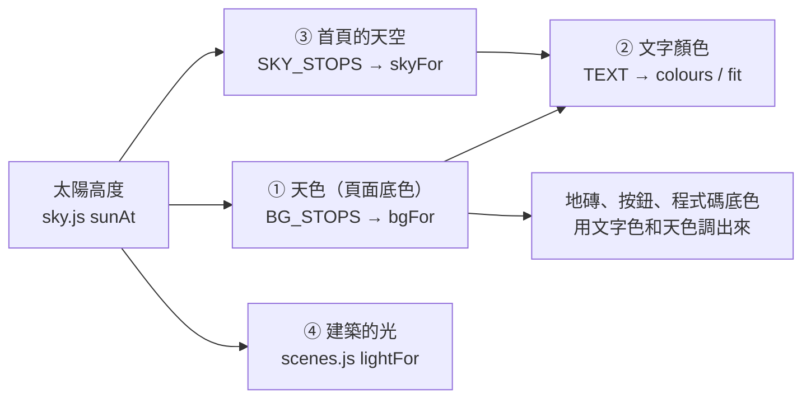
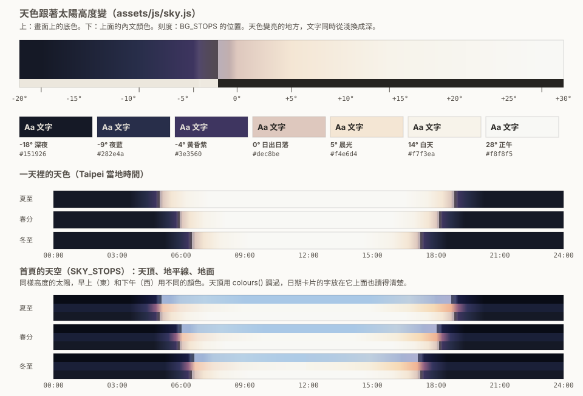
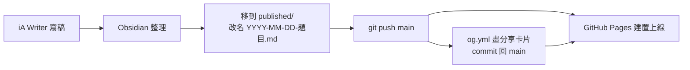
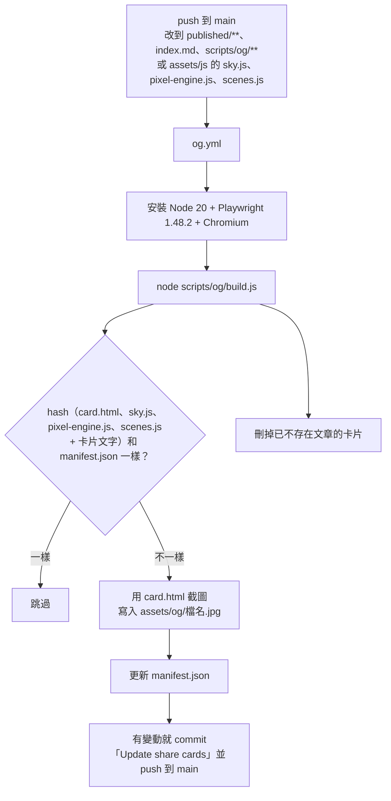
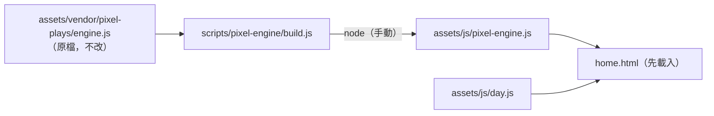
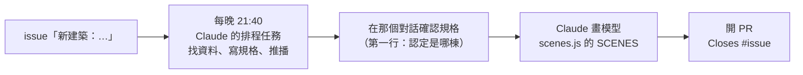

# laiyenju.github.io

Yen Lai 的個人網站：<https://laiyenju.github.io>

純 Jekyll，由 GitHub Pages 建置（`main` 分支、根目錄）。沒有主題、外掛、`Gemfile`。

| 自動 | 手動 |
|---|---|
| GitHub Pages 建置網站 | 改了 pixel 引擎 → 重新產生 `pixel-engine.js`（3.3） |
| Action 畫分享卡片（3.2） | 改了天色 → 重畫天色圖（2.5.1） |
| Action 記錄打卡（3.5） | |

## 我想要…

| 我想要 | 看這裡 |
|---|---|
| 發布一篇文章 | 3.1、2.2 |
| 加一件作品 | 2.3.1 |
| 加一個去過的地方 | 2.3.2 |
| 加一棟新的建築模型 | 3.6 |
| 改自我介紹、社群連結 | 2.4 |
| 出國時改所在城市 | 2.4 |
| 改顏色 | 2.5.1 |
| 改字型、字級、按鈕 | 2.5.3 |
| 改文章的圖片、註腳排版 | 2.5.4 |
| 在本機看網站 | 3.4 |
| 設定或修理打卡 | 3.5、[docs/checkin-setup.md](docs/checkin-setup.md) |

章節：**1** 檔案 · **2** 設定和設計規則 · **3** 流程 · **4** 待處理

---

## 1. 資料夾結構

**內容**

| 檔案 | 處理什麼 |
|---|---|
| `published/` | 已發布的文章。放進這裡就是發布（3.1） |
| `_data/works.yml` | 作品集（2.3.1） |
| `_data/days.yml` | 去過的地方：往年今日、Timeline 的每一天（2.3.2） |
| `_data/little.yml` | 小事，在今天的建築旁出現一週（2.3.3） |
| `assets/images/` | 文章圖片 |
| `_config.yml` | 網站資訊、哪些檔案要建置（2.1） |

**版面**

| 檔案 | 處理什麼 |
|---|---|
| `index.md`、`_layouts/home.html` | 首頁。`home.html` 把文章清單和 `_data/` 寫成 JSON 放進頁面，畫面全部由 `day.js` 畫 |
| `_layouts/default.html` | 文章頁。從首頁打開時放進首頁的閱讀畫面（2.4） |
| `_includes/` | `head.html`（共用的 `<head>`，在 `body` 出現前套上天色）、`seo.html`（SEO 標籤）、`theme-boot.html`（夜晚的淺色字、介面語言） |
| `notes/`、`works/` | `/notes/`、`/works/` 轉到首頁的 `?view=notes`、`?view=works` |
| `sitemap.xml`、`robots.txt` | 給搜尋引擎 |

**程式和樣式**

| 檔案 | 處理什麼 |
|---|---|
| `assets/js/sky.js` | 全站共用：所在城市、太陽位置、天色和文字顏色、首頁的天空、倒轉後沿用的時刻、翻牌時鐘 |
| `assets/js/day.js`、`assets/css/day.css` | 首頁：今天的建築、Timeline、terminal、閱讀畫面 |
| `assets/js/scenes.js` | 建築模型 `SCENES`、光線、影子、窗燈。分享卡片也用它 |
| `assets/js/pixel-engine.js` | **產生的檔案**（3.3） |
| `assets/js/post.js`、`theme.js`、`assets/css/site.css` | 文章頁：圖片、註腳、每分鐘跟著天色更新。Markdown 樣式在 `site.css` 的 `.post-prose` |
| `assets/vendor/pixel-plays/`、`scripts/pixel-engine/` | Pixel Plays 引擎原檔（MIT，作者 AmirMushich），和把它轉成 `pixel-engine.js` 的程式 |
| `assets/fonts/`、`assets/icons/` | 字型、favicon |

**自動流程和文件**

| 檔案 | 處理什麼 |
|---|---|
| `assets/og/`、`scripts/og/`、`.github/workflows/og.yml` | 分享卡片（3.2） |
| `.github/workflows/checkin.yml`、`scripts/checkin/`、`checkin` 分支 | 打卡（3.5）、外出那天的建築（3.6） |
| `scripts/sky/` | `draw.js` 從 `sky.js` 畫出天色圖 `sky.svg`（2.5.1） |
| `docs/checkin-setup.md` | iPhone 打卡捷徑的設定步驟（只做一次） |
| `CLAUDE.md` | 給 Claude 的工作規則 |

### 注意事項

| 項目 | 規則 |
|---|---|
| 產生的檔案 | `assets/js/pixel-engine.js`（3.3）、`scripts/sky/sky.svg`（2.5.1）：改來源，再重新產生 |
| `assets/og/` | Action 自動產生並 commit。不要手動改或刪 |
| `checkin` 分支 | Action 每次打卡整個覆寫（一個 commit、一個 `location.json`）。不要手動改，不要合併進 `main` |
| 打卡會寫進 `main` | 外出打卡選「當成今天的建築」時，Action 直接 commit「Today at …（check-in）」到 `main`。本機改東西前先 `git pull` |
| 草稿 | 放根目錄，檔名結尾 `.draft.md`，不會上線 |
| 不會上線的檔案 | `_config.yml` 的 `exclude`：`*.draft.md`、`README.md`、`CLAUDE.md`、`docs/`、`scripts/`、`assets/vendor/`、`assets/og/manifest.json`。新增根目錄的檔案時，確認要不要加進去 |
| 文章網址 | `published/2026-10-29-題目.md` → `/published/2026-10-29-題目.html`。改檔名會讓舊連結失效 |

### 首頁網址

分享這些網址會直接打開那個畫面。

| 網址 | 畫面 |
|---|---|
| `#timeline` | Timeline |
| `#day-YYYY-MM-DD` | Timeline 停在那天。同一天第二棟以後加 `-2`、`-3` |
| `#past-YYYY-MM-DD` | 首頁換成那天的建築 |
| `#work-<slug>` | 一件作品 |
| `#note-<檔名>` | 一篇文章，例如 `#note-2026-10-29-markdown-styles` |
| `?view=notes`、`?view=works` | 首頁打開 terminal 並執行 `ls notes`／`ls works` |

---

## 2. 可以調整的設定

只列要自己動手改的。字數、sitemap、分享卡片自動產生。

### 2.1 網站資訊：`_config.yml`

| 設定 | 預設 | 說明 |
|---|---|---|
| `title` | `Yen Lai` | 文章頁標題的後半段（「標題 · Yen Lai」） |
| `description` | 一句英文 + 一句中文 | 首頁的搜尋摘要。英文那句和 `BIO`（2.4）說同一件事 |
| `url` | `https://laiyenju.github.io` | 換網域時改 |
| `author.name` | `Yen Lai` | 結構化資料的作者 |
| `author.twitter` | `theYenLai` | X 分享卡片的帳號 |
| `og_image` | `/assets/og/home.jpg` | 文章的卡片還沒產生時用這張 |
| `lang` | `zh-Hant` | 頁面語言。單一頁面用 front matter 的 `lang` 覆蓋（`index.md` 是 `en`） |

### 2.2 文章：front matter

| 欄位 | 必填 | 預設 | 說明 |
|---|---|---|---|
| `title` | 是 | — | 標題 |
| `subtitle` | 否 | 無 | 標題下方的副標題，也是 `ls notes` 清單的第二行（沒有就用 `description`） |
| `date` | 是 | — | `YYYY-MM-DD`。決定排序和顯示的日期（不看檔名的日期） |
| `description` | 否 | 內文前 120 字 | 搜尋摘要、分享卡片的摘要 |
| `lang` | 否 | `zh-Hant` | 英文文章填 `en`。結構化資料的語言固定是 `zh-Hant`（`_includes/seo.html`） |

### 2.3 資料：`_data/`

#### 2.3.1 作品集：`works.yml`

一件作品一筆。`ls works` 依檔案順序列出，點了打開 `#work-<slug>`。全部用英文寫。

```yaml
- slug: design-lint          # 網址用，英文小寫和 -
  year: "2026"               # 文字，可以寫 "2024–25"
  title: Design Lint
  sub: 一句話說明
  role: Design and build
  problem: 當時的問題
  did: Yen 做了什麼
  result: 結果
  url: https://…             # 選填。只放公開的頁面
  url_label: open the presentation   # 選填。預設 open the portfolio
```

#### 2.3.2 去過的地方：`days.yml`

一筆是一天、一棟建築。建築底下依序顯示：「幾年前・日期」、名稱、地點（Google Maps 連結）、一句話 `Yen {did}[ with {with}].[ {extra}]`。每件事只說一次，所以 `did` 只寫發生了什麼，不寫時間、地點、建築名稱。

| 欄位 | 必填 | 說明 |
|---|---|---|
| `date` | 是 | `"YYYY-MM-DD"`，要加引號。同一天可以有好幾筆 |
| `scene` | 是 | `scenes.js` 的 `SCENES` 裡的模型名稱（見下面） |
| `name` | 是 | 英文名稱 |
| `zh` | 是 | 中文名稱。不要中文時寫 `no_zh: true` |
| `place` | 是 | 城市或地區，例如 `Sangam, Seoul` |
| `did` | 是 | Yen 做了什麼。小寫開頭，不加句號 |
| `with` | 否 | 同行者：一個人，或 `[Mei, Ken]` |
| `extra` | 否 | 補充一句 |
| `map` | 否 | Google Maps 搜尋文字。預設 `name, place` |
| `country` | 否 | 預設 `Japan`。Timeline 用它算國家數 |
| `coords` | 否 | `[緯度, 經度]`。分享卡片會印出來；外出打卡靠它認出地點（150 m 內，3.6） |

- 目前的模型：`studio`（辦公室：富邦遼寧大樓）、`home`、`itsukushima`、`naoshima`、`grandcentral`、`unitednations`、`google`、`highline`、`whitney`、`nyt`、`capitol`、`whitehouse`、`washington`、`lincoln`、`mbc`、`hongik`、`nanshan`（微風南山）。新模型見 3.6。
- 缺必填欄位或模型不存在時，那一筆不會出現，瀏覽器的 console 會列出缺了什麼。

#### 2.3.3 小事：`little.yml`

```yaml
- date: "2026-11-02"
  kind: shiba               # 模型畫得出來的：shiba
  text: Yen met a Shiba Inu on a walk this week.
```

從 `date` 起七天，今天的建築旁出現這個角色，句子接在自我介紹後面。

### 2.4 首頁內容

| 設定 | 位置 | 預設 | 要一起改 |
|---|---|---|---|
| 分頁標題 | `index.md` 的 `title` | `hey, I'm Yen` | |
| 自我介紹 | `day.js` 的 `BIO` | `Yen decides what gets built, then builds some of it. Writes about how those decisions get made.` | `scripts/og/build.js`（首頁卡片，第一人稱）、`_config.yml` 的 `description`、`seo.html` 的 `jobTitle` |
| 社群連結 | `day.js` 的 `COMMANDS.whoami` | github、linkedin、x | `seo.html` 的 `sameAs`、`_config.yml` 的 `author.twitter` |
| 所在城市 | `sky.js` 的 `CITY` | 台北（緯度、經度、時區 +8） | 出國時只改這裡。決定時間、天色、影子、標題上方的城市和座標 |
| 假日 | `scenes.js` 的 `HOLIDAYS` | 元旦、228、兒童節、勞動節、教師節、國慶、光復節、行憲紀念日 | 分享卡片也用它 |
| 上班時間 | `day.js` 的 `OFFICE_HOURS` | 09:00–18:30 | 「打卡：在家嗎」的 10:30 要在這個範圍裡 |
| 作息表 | `day.js` 的 `WEEKDAY`、`RESTDAY` | 見「Where's Yen」 | |
| 打卡的有效時間 | `day.js` 的 `CHECKIN_FRESH`、`TRANSIT_FRESH` | 6 小時、90 分鐘 | |
| terminal 的按鈕和指令 | `day.js` 的 `CHIPS`、`COMMANDS`、`ALIASES` | `❯`、About Yen、Notes、Work、Where's Yen、Clear | 樣式：`day.css` 的 `.cmdbar`、`.term` |

#### 今天的建築

建築是「今天在哪裡過」（「現在在哪」看 Where's Yen）。`day.js` 的 `todayPlace`、`todayScene` 依序判斷：

| 順序 | 條件 | 建築 |
|---|---|---|
| 0 | `days.yml` 有今天的日期（好幾筆時用最後一筆） | 那棟建築。隔天起出現在 Timeline |
| 1 | 今天在辦公室打過卡 | 辦公室（週末補班也是） |
| 2 | 週末、`HOLIDAYS` | 家 |
| 3 | 平日的上班時間打過「家」 | 家（請假、在家工作） |
| 4 | 其他平日 | 辦公室 |

- 農曆假日、請假、補班不用改程式：平日 10:30 的自動化看到手機在家，就打一次「家」。所以休假日在 10:30 前先顯示辦公室。
- 分享卡片不看打卡，只照週末和 `HOLIDAYS`。

#### Where's Yen

| 順序 | 條件 | 說什麼 |
|---|---|---|
| 1 | 6 小時內有打卡 | `Yen is {label}, Taipei. Checked in at HH:MM.` |
| 2 | 打卡是「離開家／離開辦公室」 | 只算 90 分鐘。今天是辦公室日時，離開家說 `on the way to the office` |
| 3 | 沒有有效的打卡 | 作息表 |

作息表（平日）：00–07 asleep · 07–09 on the way to the office · 09–12 at the office · 12–13:30 lunch · 13:30–18:30 at the office · 18:30–19:30 on the way home · 之後 at home。今天是家的日子用 `RESTDAY`。

#### terminal

| 項目 | 規則 |
|---|---|
| 位置 | 寬螢幕（≥ 900px）：在今天的說明下面、置中（`home.html` 的 `#barSlot`）；往下捲到 terminal 時滑進去，貼在輸入框下面。手機：固定在畫面底部，放不下時左右滑 |
| 隱藏 | Timeline、作品頁、文章打開時 |
| 一開始 | 收起來，只有按鈕（`day.css` 的 `.term:not(.on)`）。點按鈕、`❯` 或按 `/` 才打開（`openTerm`） |
| 執行指令 | 三拍：捲到日期卡片下方 → 一個字一個字打出指令 → 輸出一列一列淡入（`run`、`focusLine`、`reveal`）。這時輸入框和按鈕隱藏（`body.term-busy`） |
| 清單 | 點一列立刻打開，不打字。⌘／Ctrl 點或中鍵點：在新分頁打開文章頁 |
| `clear` | 清空、捲回頂端、收起來（`clearTerm`）。從其他畫面回到首頁時也清空；回到清單（`← Work`、`← Notes`、上一頁）時保留清單 |

#### 閱讀畫面

作品和文章共用（`day.js` 的 `openNote`、`openWork`、`backToList`）。

- 文章的內容是文章頁本身，用 `iframe` 放進來（`html.post-embed`）。所以文章的樣式只有 `site.css` 一份。
- 放在裡面時：不顯示自己的日期卡片；連結開在整個視窗；Esc 和放大圖片會通知首頁（`post.js` 的 `EMBED`、`tellHome`）。
- 回清單：從清單打開的 → 關掉，剛讀的那一列反白再退掉。從連結打開的 → 執行一次 `ls notes`／`ls works`。Home 和 Esc 回到首頁。
- 從外部連結直接打開文章頁：同樣的框架（`← Notes` 連到 `/?view=notes`、Home），標題一個字一個字打出來，文末是 `(END)`。

### 2.5 外觀

**共同規則：系統設定「減少動態效果」時，所有動畫都直接跳到結果。**

#### 2.5.1 天色：整個網站只有一條顏色規則

沒有日夜切換。**唯一的輸入是所在城市（`CITY`）現在的太陽位置**，其他顏色都從它算出來。





改了 `BG_STOPS`、`SKY_STOPS`、`TEXT` 或 `colours`：執行 `node scripts/sky/draw.js` 重畫上面的圖，和 `sky.js` 一起 commit。

**① 天色**（`sky.js` 的 `BG_STOPS`）：八個顏色點，兩點之間連續漸變。

| 太陽高度 | −18° 以下 | −9° | −4° | −1.2° | 0° | 5° | 14° | 28° 以上 |
|---|---|---|---|---|---|---|---|---|
| 顏色 | `#151926` | `#282e4a` | `#3e3560` | `#684256` | `#dec8be` | `#f4e6d4` | `#f7f3ea` | `#f8f8f5` |
| 名稱 | 深夜 | 夜藍 | 黃昏紫 | 梅紫 | 日出日落 | 晨光 | 白天 | 正午 |

- 約 −0.6° 從暗換成亮（`colours` 的 `dark`：亮度 < 0.55）。
- 梅紫（−1.2°）是玫瑰色地平線下面的地面。沒有它，紫色會直接接到暖色，中間是灰色，被 `colours` 壓暗後變成濁的灰褐色。
- 中間亮度的顏色放什麼字都不好讀，`colours` 會把它推暗或推亮（圖上「設定 → 實際」色號不同的就是）。**新的顏色點要選夠暗或夠亮的。**

**② 文字**（`sky.js` 的 `TEXT`、`fit`）：兩組顏色，天亮一組（`TEXT.day`）、天暗一組（`TEXT.night`）。

| 文字 | 最低對比 | 說明 |
|---|---|---|
| 內文（ink） | 7 | |
| 副標（soft） | 5.6 | |
| 日期、提示（faint） | 5 | |
| 強調色（accent） | 4.8 | 天亮 `#b5531e`、天暗 `#f0a46a`。分享卡片在 `scripts/og/card.html`，要一起改 |

- 對比不夠時，`fit` 把顏色往深或淺移到夠讀為止。
- 卡片底色（`sheet`）、按鈕、地磚、程式碼底色（`site.css` 的 `--washi`：天色加 7% 文字色）都從文字色和天色調出來，不用另外設定。
- 固定不變的顏色：`seo.html` 的 `theme-color`（`#fafaf7`／`#0d0f12`，跟系統設定）、分享卡片（`#fafaf7`）。`site.css` 裡的這兩個色號只在 `sky.js` 沒載入時用。
- 文章頁：`head.html`、`theme-boot.html` 在第一個畫面前套上，`theme.js` 每分鐘更新。

**③ 首頁的天空**（`sky.js` 的 `SKY_STOPS`、`skyFor`、`paintSky`；`day.js` 的 `placeSky`；`day.css` 的 `.sky`）：只在今天和往年今日。Timeline、作品、文章是單色。

- 頁面最上面是天頂，往下漸變到建築底部的地平線，再用 128px 融進地面（地面就是 ① 的天色）。距離在 `day.js` 的 `SKY_FADE`；漸層分四段、越往下越慢（`day.css` 的 `.sky`），地平線不會是一條硬線。
- 地平線：地磚後角往內 12%；沒有地磚的 `home` 在建築圖的 85% 高。
- 早上（太陽在東邊）和下午（西邊）各一組顏色；太陽在地平線下兩組相同。

| 太陽高度 | 早上：天頂 → 地平線 | 下午：天頂 → 地平線 |
|---|---|---|
| −18° 以下 | `#090c16` → `#1a2038` | 同左 |
| −9° | `#121633` → `#34355f` | 同左 |
| −4° | `#1b1e44` → `#8f5f82` | 同左 |
| 0° | `#8fa4cf` → `#f2c9b0` | `#8a8fbf` → `#f0b394` |
| 10° | `#b2c8e0` → `#f3e4d6` | `#aab8d6` → `#f6dab6` |
| 25° | `#b8d1e6` → `#f5f2ea` | `#bfcfdf` → `#f6eedd` |
| 50° 以上 | `#a9c8e6` → `#f8f8f3` | 同左 |

- 日期卡片的字放在天頂上，所以天頂也經過 `colours`，字用 `--sky-ink`、`--sky-faint`、`--sky-accent`。**新的天頂顏色要選夠暗或夠亮的**；0° 附近要能放深色字。
- 捲到地面，或打開 Timeline、作品、文章時，卡片換回一般的樣子（`day.js` 的 `updateMore`、`day.css` 的 `.top.on-ground`）。
- 星星：太陽 −6° 淡入、−12° 全亮（`--stars`）。固定的亂數種子，每晚位置一樣。

**④ 建築的光**（`scenes.js` 的 `lightFor`）：模型只畫白天的顏色，晚上由光算出來。

| 光 | 什麼時候 | 做法 |
|---|---|---|
| 整體變暗、偏藍 | 太陽 4° 以下開始，−10° 最暗 | `kr`、`kg`、`kb` 相乘；日出日落前後偏暖（`warm`） |
| 保留飽和度 | 跟著變暗 | `sat` |
| 外框變亮 | −2° 以下，−8° 最亮 | `rim`：建築的輪廓往月光色 `MOON` 移（最多一半） |
| 窗戶亮燈 | 3° 以下 | `api.emissive`；辦公大樓約兩成樓層不亮 |
| 打燈 | 3° 以下 | `api.emissive(…, 'flood')`：紀念建築、鳥居、家的室內 |
| 影子方向 | 4° 以上 | 跟著太陽方位（`sx`、`sy`） |

#### 2.5.2 建築

| 設定 | 位置 | 預設／規則 |
|---|---|---|
| 首頁建築的大小 | `day.js` 的 `sizeStage`、`homeScale`、`wholePixels` | 盡量大：框的 97%，最多 4.4 倍，取整數倍螢幕像素 |
| 建築框：寬螢幕 | `sizeStage` | 最寬 900px，高 260–760px。建築和說明在卡片下方上下置中 |
| 建築框：手機 | `sizeStage` | 畫面高度的 60%，不超過畫面寬度的 1.25 倍 |
| Timeline 的建築 | `day.js` 的 `TL_K`、`tlScale`；`day.css` 的 `--tl-k` | 首頁的 0.85 倍 |
| 地磚 | `day.js` 的 `PLATE`、`plateFor`、`placePlate` | 見「地磚」 |
| 地上的影子 | `scenes.js` 的 `SHADOW` | `reach: 6`：影子最遠離建築 6 格（矮的維持原本長度，高樓的被收短）。`far: .3`：離建築的腳越遠越淡，到 6 格時剩三成 |
| 說明上方的空間 | `day.css` 的 `.caption` 的 `padding-top` | 24px |
| 會動的細節 | `scenes.js` 的 `e.moving`（`flag`、`usFlag`、`krFlag`、`birds`、`ripples`、`beacon`） | 只在首頁動，Timeline 是靜止的。`t` 是 `null` 時畫靜止的樣子 |
| 建築的邊緣 | `scenes.js` 的 `getWorld`、`cleanShadow` | `bare` 的模型不畫地面的陰暗邊，影子邊緣整理成乾淨的線 |

**地磚**

- `bare: true` 的模型（除了 `home` 都是）站在一塊等距地磚上。大小照**碰到地面的像素**算（`scenes.js` 的 `getWorld` 算出 `foot`，`plateFor` 用它），四周多 0.6 格。懸空的部分下面要有碰地的東西，地磚才鋪得到。
- 顏色是很淡的文字色，跟著天色變。透明度有兩組（`top`、`line`、`right`、`left`）：`PLATE.day`（深色字、亮的地面，稍微重一點，建築才不會像浮著）和 `PLATE.night`。
- 進 Timeline 時收進建築中心（`suckPlate`，0.38 秒），回首頁時鋪開（`unrollPlate`，0.42 秒）。Timeline 裡沒有地磚。

**家**（`scenes.js` 的 `SCENES.home`）

| 部分 | 規則 | 位置 |
|---|---|---|
| 房子 | 兩層的鋁板盒子，+x、+y 兩面剖開看得到室內。有自己的人行道和草地，不加地磚。晚上室內亮著（`'flood'`） | `SCENES.home`、`glassPane`、`HOME_TREES` |
| 書牆 | 每篇文章把一本灰書換成彩色的書，從最上層左邊開始。最上層約放 50 本 | `bookWall`（`rows`: 8）、`NOTE_BOOKS`、`PLAIN_BOOKS` |
| 柴犬 | 沿著路線繞一圈 | `HOME_WALK` |
| 貓 | 坐在沙發椅背上，每 24 秒走到另一頭 | `cat`、`catWalking`、`catOnSofa` |

Timeline 的靜止版沒有柴犬和貓。

#### 2.5.3 介面

| 設定 | 位置 | 預設 |
|---|---|---|
| 字型檔 | Quattro：`assets/fonts/quattro/`（`site.css`、`day.css` 開頭載入）。JetBrains Mono、Noto Sans TC：Google Fonts（`head.html`、`home.html`） | 見「字型」 |
| 首頁字級 | `day.css` 的 `.caption .name`、`.caption .note` | 21px，行高 1.5 |
| 標題上方的城市 | `day.js` 的 `geoLine`；`day.css` 的 `.geo-tag` | `Taipei  25.03° N 121.56° E`。座標只到小數 2 位（約 1 公里） |
| 往年今日的標籤 | `day.js` 的 `whenTag`；`day.css` 的 `.past-tag` | 強調色的「幾年前・日期」 |
| 日期卡片 | 首頁：`home.html` 的 `.top-row`、`day.css` 的 `.top`。文章頁：`default.html` 的 `.post-row`、`site.css` 的 `.post-top` | `--card-top`、`--card-title`（15px）、`--card-sub`（12px）在 `day.css` 和 `site.css` 各一份，**要一起改** |
| 按鈕 | `day.css` 的 `.top-btn, .cmdbar button`、`--press-soft`；文章頁 `site.css` 的 `.post-btn` | 見「按鈕」 |
| 倒轉今天 | `day.js` 的 rewind 區段；`day.css` 的 `.when.is-rewound`、`.dayline` | 見「倒轉今天」 |
| 轉場 | `day.js` 的 `lightRow`、`reveal`、`openTl`、`leaveTl`；`site.css` 的 `post-rise` | 見「轉場」 |
| Timeline | `day.js` 的 `buildUp`、`dissolve`、`MOVE`、`renderRuler`、`renderRow`、`ROW` | 見「Timeline」 |

**字型**

| 用在 | 字型 |
|---|---|
| 一般文字（說明、Timeline、作品、文章） | iA Writer Quattro → Noto Sans TC |
| terminal、日期、按鈕 | JetBrains Mono → Noto Sans TC |

Quattro 只有 400、700，所以 Noto Sans TC 也只載入這兩個粗細。

**日期卡片**：頂部一行，置中，最寬 440px。

| 畫面 | 左 | 中間 | 右（`ctaFor`） |
|---|---|---|---|
| 今天的首頁 | | 時間 `HH:MM:SS`、星期 | Today → 打開 Timeline |
| Timeline | | 那天的日期、「幾年前」 | Timeline → 回到今天 |
| 過去某天（`#past-`） | | 時間、星期 | Today → 回到今天 |
| 倒轉今天時 | | 倒轉到的時間（強調色） | Now → 回到現在 |
| 作品、文章 | `← Work`／`← Notes` | 時間、星期 | Home |

- 離頂端 `--card-top`：手機 12px；寬螢幕是畫面高度的 9%（28–96px）。
- 數字像翻牌一樣捲到下一個（`sky.js` 的 `rollClock`）。首頁由 `day.js` 的 `secondTick` 呼叫，文章頁由 `post.js` 的 `tick`。
- 進出 Timeline 時，時間和日期交叉淡入淡出（`dialTo`、`.when .face`）。
- 底下有一條往下淡出的天色帶子。首頁最上面卡片在天空上，沒有帶子（2.5.1 ③）。

**按鈕**：全站只有一種。

| 狀態 | 樣子 |
|---|---|
| 平常 | 等寬字 13px，沒有框和底色。`❯` 用強調色 |
| 滑鼠指到 | 7% 文字色的底（只在有滑鼠的裝置） |
| 按下、清單選中 | 整塊反白：文字色底、天色字、直角，左右多 10px（`.ls .lit`） |
| 鍵盤移到 | 強調色的直角框 |

**倒轉今天**（只在今天的首頁）

| 操作 | 結果 |
|---|---|
| 在建築上左右拖（觸控板：兩指左右滑） | 往左是更早。範圍：今天 00:00 到現在 |
| 長按建築 0.35 秒（`HOLD`） | 出現太陽的軌跡，接著左右滑 |
| 快速點一下建築 | 打開 Timeline |
| 在時間上拖 | 同樣倒轉 |
| 鍵盤（Tab 到時間） | `←` `→` 15 分鐘，加 Shift 1 小時，Home 到 00:00，End 回到現在 |
| 點 Now，或放著 60 秒（`IDLE_BACK`） | 回到現在 |

| 參數 | 預設 | 意思 |
|---|---|---|
| `SUN_MARKS` | 黎明、黃昏（−4°）、日出、日落（0°） | 吸附點 |
| `SNAP` | 8 分鐘 | 吸附點前後多遠會停住 |
| `PULL` | 10 px | 多拉多少才離開吸附點 |
| `GAIN_MAX` | 8 | 拖得最快時每 px 幾分鐘（最慢 1） |
| `FLING_MAX` | 0.9 | 放開後繼續滑的最快速度（分鐘／毫秒） |
| `DL.LIFT` | 44 px | 太陽軌跡放在手指上方多高 |

- 跟著變的：天色、文字色、建築的光和影子（`minuteMs`）。真正的時間 `state.minute` 不變，Where's Yen 還是說現在。
- 太陽的軌跡（`paintDayline`、`placeDayline`、`.dayline`）：拖動時出現在建築中間。有地平線、太陽走過的弧線、那一刻的時間、天色條。
- 影子最多每 0.18 秒重畫一次（`swing`）。頁面底色的淡入從 1.2 秒縮成 0.12 秒（`body.rewinding`）。
- **全站同一片天**：倒轉後離開首頁，天色留在那一刻（`sessionStorage` 的 `skyAt`；`sky.js` 的 `keepAt`、`shownMs`；`day.js` 的 `showAt`、`resetAt`、`resumeAt`）。只在同一個分頁、同一天有效。
- 讓人發現：第一次來的訪客，約 2.4 秒後時間自己往回翻 40 分鐘再回來，只播一次（`localStorage` 的 `teased`）。還沒倒轉過時，時間左邊有淡淡的 `‹`（`rewound`）。
- 過去某天的首頁（`#past-`）沒有倒轉，在建築上左右滑是切換年份（`drag.mode`：`time`／`h`）。

**轉場**

| 動作 | 樣子 |
|---|---|
| terminal 的輸出 | 一列一列往上浮現 |
| 清單點一列 | 那一列反白 0.11 秒再打開 |
| 打開作品、文章 | 直接切過去，內容約 0.25 秒浮現 |
| 進出 Timeline | 今天的文字先退開，Timeline 的文字才出現。建築移動 0.48 秒（`MOVE`） |
| Timeline 換一天 | 一磚一磚蓋起來 0.9 秒（`buildUp`，磚塊 4×3 像素），溶解 0.2 秒（`dissolve`） |

**Timeline**

- 尺標：每棟建築一格、等距（同一天的間距減半），最舊的在左邊。點一格、按住左右滑、或用方向鍵切換。
- 手機：尺標固定在畫面底部，不顯示兩旁的建築。
- 寬螢幕：尺標在建築名稱下面；其他天的建築排在兩旁（小、灰、半透明），點一棟就切過去。

#### 2.5.4 文章頁

| 設定 | 位置 | 預設 |
|---|---|---|
| 文章欄寬 | `site.css` | 680px |
| 單張圖片 | `site.css` 的 `.post-fig`；`post.js` 的 `buildFigures` | 和內文同寬。直式（高 > 寬 × 1.1）是 80% |
| 並排圖片 | `site.css` 的 `.post-gallery` | 同一段有兩張以上時並排，總寬 960px，間距 20px。手機（≤ 640px）上下排 |
| 圖片放大 | `site.css` 的 `.lb`；`post.js` 的 `buildLightbox` | 寬螢幕：左欄 320px 放關閉、圖說、張數。窄螢幕（≤ 767px）：上下排。Esc 關閉，左右鍵或滑動切換 |
| 註腳放側欄的最小寬度 | `post.js` 的 `RAIL_MIN` | 1088px。較窄時放文末。要和欄寬一起算 |
| 內文標題 | `post.js` 的 `runInHeadings` | 後面接一般段落時，併進段落開頭、用強調色。後面接清單、表格、圖片、標題時自己一行 |

### 2.6 介面語言

首頁全部是英文（只有文章標題和地點的 `zh` 是中文）。文章頁依瀏覽器的第一語言：中文顯示中文，其他顯示英文。文章頁新增介面文字時，兩種都要寫：

| 位置 | 寫法 |
|---|---|
| HTML | `<span class="i-en">…</span><span class="i-zh">…</span>` |
| JS | `t("English", "中文")` |
| `aria-label`／`title` | 預設寫英文，中文寫在 `data-label-zh`／`data-title-zh` |

---

## 3. 流程

### 3.1 寫作與發布



1. 把檔案移進 `published/`，檔名 `YYYY-MM-DD-題目.md`。
2. 寫好 front matter（2.2）。
3. `git push` 到 `main`。其他都是自動的。

| 寫法 | 規則 |
|---|---|
| 內文標題 | 寫短一點，它會變成段落的開頭（2.5.4） |
| 圖片 | ``。不寫引號就沒有圖說 |
| 並排圖片 | 兩張以上放在同一段（連續幾行，中間不空行） |
| 檔名 | `cat` 指令和分享卡片上會去掉日期（`markdown-styles.md`） |

### 3.2 分享卡片（自動）



卡片是一張明信片（`scripts/og/card.html`）：

| 部分 | 內容 |
|---|---|
| 左：建築 | 文章那天在 `days.yml` 有地點 → 那棟建築、名稱、城市・國家、`coords`。沒有 → 平日辦公室，週末和 `HOLIDAYS` 是家（`build.js` 的 `places`） |
| 右：文字 | 郵戳（城市、日期、星期）、`cat notes/<檔名>`、標題、副標題（沒有就用摘要）、寄件地址 |
| 首頁的卡片 | 辦公室，郵戳不寫日期 |

- 改了 `card.html` 或畫建築的程式，所有卡片都會重畫。
- 手動執行：GitHub → Actions → Share cards → **Run workflow**。
- 本機執行：

  ```bash
  npm install --no-save playwright && npx playwright install chromium && node scripts/og/build.js
  ```

### 3.3 pixel 引擎（手動產生）



`build.js` 把只畫一個場景的引擎包成 `createPixelEngine(canvas, SCENE)`，加上每個場景的畫布大小、比例、平面旋轉。改了原檔或 `build.js` 後執行，再把 `pixel-engine.js` 一起 commit：

```bash
node scripts/pixel-engine/build.js
```

新增建築模型不用重新產生（模型在 `scenes.js`）。

### 3.4 本機預覽

```bash
jekyll serve
```

首頁的資料是 Jekyll 寫進頁面的，不能直接打開 HTML 檔。輸出在 `_site/`（已在 `.gitignore`）。

### 3.5 打卡（自動）


**第一次設定**（token、五個捷徑、五個自動化）：[docs/checkin-setup.md](docs/checkin-setup.md)。

`location.json` 只有文字，沒有座標：

| 欄位 | 內容 |
|---|---|
| `place` | `home`、`office`、`out`、`left_home`、`left_office` |
| `label` | 接在「Yen is」後面的話，例如 `at a café in Daan`，最多 60 字。沒填就用 `update.js` 的 `LABELS`：`at home`、`at the office`、`out somewhere in the city`、`heading out`、`on the way home` |
| `at` | 打卡時間（UTC） |
| `office_at` | 最近一次在辦公室打卡的時間。首頁用它判斷今天是不是辦公室（2.4） |
| `homes` | 24 小時內所有「家」的打卡時間。平日有一次落在上班時間，今天就是家（2.4） |

| 狀況 | 做法 |
|---|---|
| token 到期（一年） | 做新的 token，換掉五個打卡捷徑的 `Authorization`。沒換時打卡停住，首頁照週末、`HOLIDAYS` 和作息表顯示 |
| 不用手機打卡 | GitHub → Actions → **Check in** → Run workflow，選 `place`、填 `label` |
| 捷徑跳出錯誤訊息 | 對照 [docs/checkin-setup.md](docs/checkin-setup.md) 步驟 3 的表 |

### 3.6 外出那天的建築、新建築

外出打卡時，捷徑問「要當成今天的建築嗎？」。選「是」就送出手機的位置（`latlon`）：

| 位置 | 結果 |
|---|---|
| 150 m 內有 `days.yml` 的地點（看 `coords`） | `scripts/checkin/day.js` 複製那個地點的資料，加上今天和 `did`，commit 到 `main`。幾分鐘後首頁換成那棟 |
| 附近沒有 | 開 issue「新建築：…」（地點名稱、地址、地圖連結） |
| 選「否」 | 只改 Where's Yen |

- `did` 是建築底下那句話（`Yen {did}.`）。沒填時是 `spent time here`。
- 位置只用來比對和放進 issue，不寫進 `location.json`。**但 issue 和 Actions 的紀錄是公開的**，會讓人知道當下在哪裡。

**新建築模型**



- 做法和檢查規則在 `CLAUDE.md` 的「新建築模型」。
- 新模型在 `days.yml` 的那筆一定要有 `coords`，下次在那裡打卡才認得出來。
- 模型加進 `SCENES` 後，更新 2.3.2 的模型清單。

**測試**（改了 `checkin.yml` 或 `scripts/checkin/day.js` 後做一次）：GitHub → Actions → Check in → Run workflow。分支選要測的分支（不要選 `main`），`place` 選 `out`。

| `latlon` | 應該發生 |
|---|---|
| `25.0346,121.5667`（南山） | 那個分支的 `days.yml` 多一筆今天 |
| `25.0339,121.5645`（台北 101，沒有模型） | 出現一個 issue。測完關掉 |

兩次都會真的改 Where's Yen，測完再打一次卡。

---

## 4. 待處理

| # | 項目 | 狀況 | 建議 |
|---|------|------|------|
| 1 | `published/2026-03-08-hello.md` | 範例文章，已公開上線、在 sitemap 裡 | 第一篇正式文章上線後刪除 |
| 2 | `published/2026-10-29-markdown-styles.md` + `assets/images/markdown-sample*.svg`（三張） | 樣式測試頁，也公開上線 | 想保留當測試頁，可移到根目錄改成 `.draft.md`（但本機預覽就看不到）；或加 front matter `sitemap: false`，並在 `sitemap.xml`、首頁 notes 清單加條件排除 |
