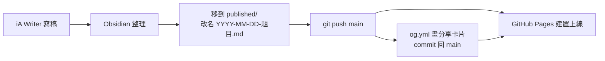
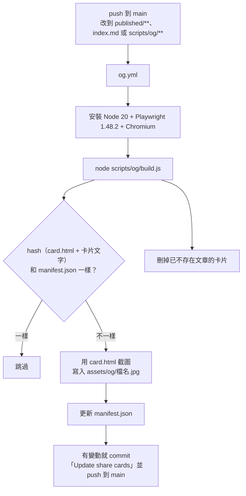
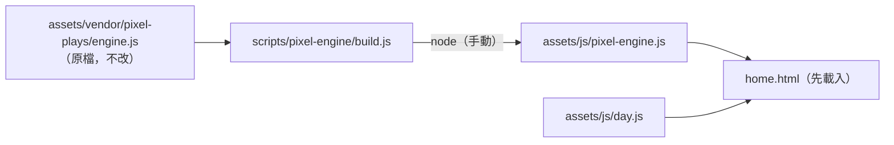

# laiyenju.github.io

Yen Lai 的個人網站：<https://laiyenju.github.io>

- 純 Jekyll，由 GitHub Pages 建置（`main` 分支、根目錄）。沒有主題，沒有外掛，沒有 `Gemfile`。
- 只有兩個自動流程：**GitHub Pages 建置網站**、**GitHub Action 畫分享卡片**。
- 只有一個手動步驟：改了 pixel 引擎（`assets/vendor/pixel-plays/engine.js`）或 `scripts/pixel-engine/build.js` 之後，要重新產生 `assets/js/pixel-engine.js`（見 3.3）。

---

## 1. 資料夾結構

| 資料夾／檔案 | 處理什麼 |
|---|---|
| `published/` | 已發布的文章。放進這裡就是發布 |
| `index.md`、`_layouts/home.html` | 首頁：每天一棟 pixel 建築、Timeline、下方的 terminal（notes、works 都在 terminal 裡）。`home.html` 把文章清單和 `_data/` 的資料寫成 JSON 放進頁面，畫面全部由 `assets/js/day.js` 畫出來 |
| `_layouts/default.html` | 文章頁。和首頁的作品頁同一個框架：頂部日期卡片（點了開 Timeline，時間由 `assets/js/post.js` 的 `tick` 填）、`yen@taipei ~ $ cat notes/<檔名>.md`、靠左的標題、文末的 terminal 和 `← cd ..` |
| `_includes/` | 每頁共用的 `<head>`、SEO 標籤、文章頁在第一次畫面前套上天色與介面語言（`theme-boot.html`） |
| `_data/works.yml` | 作品集（terminal 的 `ls works`，每件作品一頁 `#work-<slug>`） |
| `_data/days.yml` | 去過的地方：首頁的往年今日建築、Timeline 的每一天 |
| `_data/little.yml` | 小事（例如散步遇到柴犬），在今天的建築旁出現一週 |
| `_config.yml` | 網站資訊、哪些檔案要建置 |
| `assets/css/`、`assets/js/` | 兩邊共用：`sky.js`（所在城市、太陽位置、依太陽決定的背景顏色）。首頁：`day.css`、`day.js`（建築模型 `SCENES`、Timeline、terminal、影子和窗燈）、`pixel-engine.js`（產生的檔案）。文章頁：`site.css`、`theme.js`（每分鐘跟著天色更新）、`post.js`。Markdown 樣式在 `site.css` 的 `.post-prose`；文章圖片排版和點開放大在 `assets/js/post.js`（`buildFigures`、`buildLightbox`）和 `site.css` 的 `.post-fig`、`.post-gallery`、`.lb` |
| `assets/vendor/pixel-plays/`、`scripts/pixel-engine/` | Pixel Plays 引擎原檔（MIT，作者 AmirMushich，`LICENSE` 在同一個資料夾）和把它轉成 `assets/js/pixel-engine.js` 的程式 |
| `assets/og/`、`scripts/og/`、`.github/workflows/og.yml` | 分享卡片：圖檔、產生程式、自動執行的 Action |
| `assets/icons/`、`assets/fonts/`、`assets/images/` | favicon、文章字型、文章圖片 |
| `notes/`、`works/` | `/notes/`、`/works/` 網址轉到首頁的 `?view=notes`、`?view=works`，首頁會捲到 terminal 並執行 `ls notes`／`ls works`。文章頁的 `cd ..` 不經過這裡：從 notes 清單點進來的文章用瀏覽器的「上一頁」回去，其他情況直接連到 `/?view=notes`（`assets/js/post.js` 的 `backToNotes`） |
| `sitemap.xml`、`robots.txt` | 給搜尋引擎的檔案 |
| `CLAUDE.md` | 給 Claude 的工作規則（例如：改檔案時要同時更新 README） |

### 注意事項

| 項目 | 說明 |
|---|---|
| `assets/js/pixel-engine.js` | 產生的檔案，不要直接改。改 `assets/vendor/pixel-plays/engine.js` 或 `scripts/pixel-engine/build.js` 後重新產生（見 3.3） |
| 首頁網址 | `#timeline`、`#day-YYYY-MM-DD`（Timeline 停在那天；同一天第二棟以後加 `-2`、`-3`）、`#past-YYYY-MM-DD`（和首頁同一個畫面，只是主建築換成那天的，標題上方有一行主題色的「幾年前・日期」（`day.css` 的 `.past-tag`）；頂部按鈕變成 Today，點了回到今天；點建築打開 Timeline 的那一天）、`#work-<slug>`（一件作品）。分享這些網址會直接打開那個畫面 |
| `assets/og/` | Action 自動產生並 commit，不要手動改或刪 |
| 草稿 | repo 裡目前沒有草稿。要把草稿放進 repo，就放在根目錄，檔名結尾用 `.draft.md`，不會上線 |
| 不會上線的檔案 | 根目錄的 `*.draft.md`、`README.md`、`CLAUDE.md`、`scripts/`、`assets/vendor/`、`assets/og/manifest.json`（`_config.yml` 的 `exclude`） |
| 文章網址 | `published/2026-10-29-題目.md` → `/published/2026-10-29-題目.html`。改檔名會改網址，舊連結會失效 |

---

## 2. 可以調整的設定

只列出要自己動手改的設定。字數、sitemap、分享卡片這些會自動產生，不用管。

### 2.1 網站資訊：`_config.yml`

| 設定 | 預設 | 說明 |
|---|---|---|
| `title` | `Yen Lai` | 文章頁標題的後半段（「標題 · Yen Lai」） |
| `description` | 一句英文 + 一句中文 | 首頁的搜尋摘要 |
| `url` | `https://laiyenju.github.io` | 換網域時要改 |
| `author.name` | `Yen Lai` | 結構化資料的作者 |
| `author.twitter` | `theYenLai` | X 分享卡片的帳號 |
| `og_image` | `/assets/og/home.jpg` | 文章的卡片還沒產生時，先用這張 |
| `lang` | `zh-Hant` | 頁面語言。單一頁面可以在 front matter 用 `lang` 覆蓋（`index.md` 設成 `en`） |

### 2.2 文章：front matter

| 欄位 | 必填 | 預設 | 說明 |
|---|---|---|---|
| `title` | 是 | — | 標題 |
| `subtitle` | 否 | 無 | 副標題，顯示在標題下方，也是首頁 terminal `ls notes` 清單裡標題下面那一行。不填就沒有這一行（清單改用 `description`，也沒有就只顯示標題） |
| `date` | 是 | — | 格式 `YYYY-MM-DD`。決定排序和顯示的日期（不是看檔名的日期）；`total` 字數只算今年的文章 |
| `description` | 否 | 內文前 120 字 | 搜尋摘要，也是分享卡片上的摘要 |
| `lang` | 否 | `zh-Hant` | 英文文章填 `en`，會改 `<html lang>` 和 `og:locale`。結構化資料的語言固定是 `zh-Hant`（`_includes/seo.html`） |

### 2.3 作品集：`_data/works.yml`

一件作品一筆，terminal 的 `ls works` 依檔案順序列出，點了打開那件作品的頁面（`#work-<slug>`）：

```yaml
- slug: design-lint          # 網址用，英文小寫和 -
  year: "2026"               # 文字，可以寫 "2024–25"
  title: Design Lint
  sub: 一句話說明
  role: Design and build
  problem: 當時的問題
  did: Yen 做了什麼
  result: 結果
  url: https://…             # 選填；只放公開的頁面，私人 repo 不要放
  url_label: open the presentation   # 選填，連結文字，預設 open the portfolio
```

全部用英文寫（網站介面一律英文，只有文章可以是中文）。

### 2.3.1 去過的地方：`_data/days.yml`

一筆是一天、一棟建築。建築底下的句子由同一條規則組出來：`{幾年前}, {prep} {place}, Yen {did}[ with {with}].[ {extra}]`

| 欄位 | 必填 | 說明 |
|---|---|---|
| `date` | 是 | `"YYYY-MM-DD"`，要加引號。同一天可以有好幾筆（好幾棟建築），網址會依順序變成 `#day-2019-01-26`、`#day-2019-01-26-2`… |
| `scene` | 是 | 建築模型的名字，要先在 `assets/js/day.js` 的 `SCENES` 裡有這個模型。目前有：`studio`（工作地點：富邦遼寧大樓）、`home`（家）、`itsukushima`、`naoshima`、`grandcentral`、`unitednations`、`google`、`highline`、`whitney`、`nyt`、`capitol`、`whitehouse`、`washington`、`lincoln`、`mbc`、`hongik` |
| `name` | 是 | 英文名稱 |
| `zh` | 是 | 中文名稱。不要中文時改寫 `no_zh: true` |
| `place` | 是 | 城市或地區，例如 `Sangam, Seoul`，會變成 Google Maps 連結 |
| `did` | 是 | Yen 做了什麼，小寫開頭、不加句號 |
| `prep` | 否 | `in`（預設）或 `on`（島） |
| `with` | 否 | 同行者，一個人或一串 `[Mei, Ken]` |
| `extra` | 否 | 補充一句 |
| `map` | 否 | Google Maps 搜尋文字，預設用 `name, place` |
| `country` | 否 | 預設 `Japan`。Timeline 的國家數由它算 |

缺必填欄位、沒有中文名、或模型不存在時，那一筆不會出現，瀏覽器的 console 會列出缺了什麼。

### 2.3.2 小事：`_data/little.yml`

```yaml
- date: "2026-11-02"
  kind: shiba               # 模型畫得出來的：shiba
  text: Yen met a Shiba Inu on a walk this week.
```

從 `date` 起七天內，今天的建築旁會出現這個角色，句子接在自我介紹後面。

### 2.4 首頁內容

| 設定 | 位置 | 預設 | 注意 |
|---|---|---|---|
| 自我介紹 | `assets/js/day.js` 的 `BIO` | `Product manager in Taipei. Writes about how products get decided.` | 今天的建築底下和 terminal 的 `whoami` 都用它。一起改：文章頁 `whoami`（`assets/js/post.js`）、首頁分享卡片文字（`scripts/og/build.js`）、職稱（`_includes/seo.html` 的 `jobTitle`） |
| 社群連結 | `assets/js/day.js` 的 `whoami` | github、linkedin、x | 首頁不直接放連結，要執行 `whoami` 才看得到。一起改：`_includes/seo.html` 的 `sameAs`；X 帳號另有 `_config.yml` 的 `author.twitter` |
| 平日／假日 | `assets/js/day.js` 的 `HOLIDAYS` | 週六日和固定日期的國定假日（元旦、228、兒童節、勞動節、國慶）是「家」，其他是「工作室」 | 農曆假日（春節、清明、端午、中秋）每年日期不同，要每年補進 `HOLIDAYS` |
| 所在城市 | `assets/js/sky.js` 的 `CITY` | 台北（緯度、經度、時區 +8） | 決定頂部時間、首頁和文章頁的背景顏色、影子方向。出國時只要改這裡，首頁和文章頁的時間、提示字 `yen@taipei` 都會跟著變 |
| 「Where is Yen now」的作息 | `assets/js/day.js` 的 `WEEKDAY`、`RESTDAY` | 平日：00–07 asleep、07–09 on the way to the office、09–12 at the office、12–13:30 lunch、13:30–18:30 at the office、18:30–19:30 on the way home、之後 at home；假日另一張表 | `CHECKIN` 之後會接自動打卡（見第 4 節） |
| terminal 按鈕 | `assets/js/day.js` 的 `CHIPS`、`placeBar`；樣式在 `assets/css/day.css` 的 `.cmdbar` | `$`、About Yen、Notes、Work、Where's Yen、Clear | 整個首頁只有這一排。寬螢幕（≥ 900px）：一開始在今天的說明下面（`_layouts/home.html` 的 `#barSlot`），往下捲到 terminal 時滑進 terminal、貼在輸入框下面，捲回去再滑回來。手機：一直固定在畫面底部。沒有分隔線，用漸層讓內容淡入按鈕下面。只在 Timeline、作品頁打開時隱藏。點了會打出真正的指令，並把這一行捲到日期卡片正下方，輸出從那裡往下讀（`day.js` 的 `focusLine`；頁面不夠長時 terminal 下方會自動留白）；點 `$` 也會把輸入框捲到那裡。放不下時可以左右滑，右邊會淡出提示。可輸入的指令在 `COMMANDS`。`clear` 會清空 terminal 並捲回頂端（在 `run` 裡） |
| 瀏覽器分頁標題 | `index.md` 的 `title` | `hey, I'm Yen` | |

### 2.5 外觀

| 設定 | 位置 | 預設 | 其他選項／注意 |
|---|---|---|---|
| 首頁和文章頁顏色 | `assets/js/sky.js` 的 `BG_STOPS`（背景）、`TEXT`（文字原本的顏色）、`colours`；首頁的光線和窗燈在 `day.js` 的 `lightFor` | 跟著 `CITY` 的真實太陽高度變：白天接近白、黃昏暖色、夜晚深藍；晚上窗戶亮燈。整個網站沒有日夜切換，只有這一條規則 | 每一種文字顏色（內文、副標、日期與提示、強調色）都先用 `TEXT` 的顏色，讀不清楚時才往深或淺移一點，對比至少 4.5。黃昏的中間色也會稍微調深或調淺。程式碼區塊和行內程式碼的底色是「天色加一點文字色」（`site.css` 的 `--washi`），任何時間都看得出邊界 |
| 首頁字級 | `assets/css/day.css` 的 `.caption .name`、`.caption .note`、`.when b` | 今天的標題 21px（行高 1.45）、說明 17px（行高 1.65，和標題之間多 10px）；頂部日期首頁 14px、Timeline 19px | |
| 建築大小 | `assets/js/day.js` 的 `sizeStage`、`fitCanvas`（`* .86`）、`fitTl`（`* .86`） | 手機：建築用掉說明文字和底部按鈕列以外剩下的空間（最多畫面一半高）；還有空間時平均分到上下，讓建築和說明靠在一起、整組置中。沒有往年今日時，縮圖那一列會收起來（`day.css` 的 `.tools:has(.thumbs.none)`） | 寬螢幕往下捲到 terminal 時，建築移到中間、右邊的文字和年份縮圖淡出（`onScroll` 的 `--dx`、`--q`）。大小和位置只看建築本身；影子完整畫出來，可以超出建築的範圍、壓到文字下面（`getWorld` 的 `pad`、`fitCanvas` 的負 margin），手機上只會在螢幕邊緣被切掉。縮圖不含超出的影子 |
| Timeline 的動畫 | `assets/js/day.js` 的 `buildUp`（一磚一磚，磚塊 4×3 像素）、`dissolve`、`MOVE` | 蓋起來 0.9 秒、溶解 0.2 秒、首頁和 Timeline 之間移動 0.48 秒 | 系統設定「減少動態效果」時都直接跳到結果 |
| Timeline 的尺標 | `assets/js/day.js` 的 `renderRuler`；樣式在 `assets/css/day.css` 的 `.ruler-track` | 每棟建築一格、等距排列（同一天的建築間距減半），最舊的在左邊；不標年份（頂部日期已經有） | 點一格跳過去；手指按住左右滑可以快速切換（滑動時不播動畫，放開就停在那棟）；鍵盤可用左右方向鍵 |
| 強調色 | `assets/js/sky.js` 的 `TEXT.day.accent`、`TEXT.night.accent` | 白天 `#b5531e`（朱）、天暗時 `#f0a46a`（橘） | 首頁和文章頁共用（文章的 `--accent`、`--shu` 都從這裡來，內文標題也用這個顏色）。分享卡片在 `scripts/og/card.html`，要一起改 |
| 文章頁底色 | `assets/js/sky.js`（和首頁同一個天色） | 跟著天色 | `site.css` 裡的 `#fafaf7`、`#0d0f12` 只在 `sky.js` 沒載入時用。`_includes/seo.html` 的 `theme-color`（瀏覽器網址列的顏色，跟著系統設定用 `#fafaf7`／`#0d0f12`）和 `scripts/og/card.html`（分享卡片，`#fafaf7`）是固定的 |
| 網頁字型 | 英文一般文字：iA Writer Quattro（`assets/fonts/quattro/`，文章頁在 `site.css`、首頁在 `day.css` 開頭載入）。程式字體：JetBrains Mono。中文：Noto Sans TC。後兩個從 Google Fonts 載入（文章頁 `_includes/head.html`、首頁 `_layouts/home.html`） | 一般文字（首頁說明、Timeline、作品頁、文章）：Quattro → Noto Sans TC。terminal、日期、按鈕：JetBrains Mono → Noto Sans TC | 英文字體放前面、Noto Sans TC 放後面，瀏覽器一個字一個字自動選，中文一律用 Noto Sans TC。Quattro 只有 400、700，所以 Noto Sans TC 也只載入 400、700，一般文字只用這兩種粗細，中英文才會一樣粗。中英文之間的小空隙用 `text-autospace`（支援的瀏覽器才有）。notes 和 works 用同一種清單（`day.css` 的 `.ls`） |
| 文章圖片排版 | `assets/css/site.css` 的 `.post-fig`、`.post-gallery` | 單張和內文同寬；直式圖片（高 > 寬 × 1.1）寬度 `80%`；同一段有兩張以上時並排，總寬 `960px`，間距 `20px`；手機（≤ 640px）上下排列 | 並排的圖片會伸到側欄，`post.js` 會把側欄註腳往下推，避開圖片 |
| 圖片放大檢視 | `assets/css/site.css` 的 `.lb`（`assets/js/post.js` 的 `buildLightbox`） | 寬螢幕：左欄 `320px` 放關閉、圖說、上一張／張數／下一張，細線隔開右邊的圖片；窄螢幕（≤ 767px）：上面關閉和箭頭，下面張數和圖說 | 鍵盤：Esc 關閉、左右鍵切換；手機左右滑動切換；點圖片關閉。一篇文章的圖片會依序循環 |
| 註腳放側欄的最小寬度 | `assets/js/post.js` 的 `RAIL_MIN` | `1088`（px） | 較窄時放文末。要和 `site.css` 的文章欄寬（680px）一起算 |

### 2.6 介面語言

首頁全部是英文，只有文章標題和地點的中文名（`zh`）是中文。文章頁沒有設定可以改：瀏覽器第一語言是中文就顯示中文，其他顯示英文。文章頁新增介面文字時，兩種語言都要寫：

| 位置 | 寫法 |
|---|---|
| HTML | `<span class="i-en">…</span><span class="i-zh">…</span>` |
| JS | `t("English", "中文")` |
| `aria-label`／`title` | 預設寫英文，中文寫在 `data-label-zh`／`data-title-zh` |

---

## 3. 流程

### 3.1 寫作與發布



1. 草稿可以不放進 repo；要放的話見第 1 節的「草稿」。
2. 發布 = 把檔案移進 `published/`，檔名用 `YYYY-MM-DD-題目.md`。
3. 寫好 front matter（見 2.2）。
4. `git push` 到 `main`，其他都是自動的。

內文標題（`##` 到 `######`）後面接一般段落時，會併進那一段的開頭，用強調色顯示（`assets/js/post.js` 的 `runInHeadings`）；後面接清單、表格、圖片或另一個標題時，自己一行。標題不要寫得太長，讀起來才像段落的開頭。

圖片的寫法：``。引號裡的文字是圖說，不寫就沒有圖說。一張圖自己一段；要並排就把兩張以上的圖片放在同一段（連續幾行，中間不空行）。

notes 清單顯示的是 `title`；從清單點開文章時，`cat` 指令和分享卡片上的檔名會去掉日期（`markdown-styles.md`）。

### 3.2 分享卡片（自動）



- 改了 `card.html`，所有卡片都會重畫。新文章的卡片產生前，先用 `home.jpg`。
- 目前的三張卡片是手動產生後 commit 的，Action 還沒有自己 commit 過卡片。第一篇新文章 push 後，到 GitHub → Actions 確認它有執行成功。
- 也可以在 GitHub → Actions → Share cards → **Run workflow** 手動執行。
- 本機執行：

  ```bash
  npm install --no-save playwright && npx playwright install chromium && node scripts/og/build.js
  ```

### 3.3 pixel 引擎（手動產生）



`build.js` 把原本只畫一個場景的引擎包成 `createPixelEngine(canvas, SCENE)`，讓首頁可以同時有好幾個場景，並加上每個場景的畫布大小、比例和平面旋轉。改了原檔或 `build.js` 之後執行，再把 `pixel-engine.js` 一起 commit：

```bash
node scripts/pixel-engine/build.js
```

新增建築模型不用重新產生：模型寫在 `assets/js/day.js` 的 `SCENES`。

### 3.4 本機預覽

```bash
jekyll serve
```

首頁的資料是 Jekyll 寫進頁面的，所以要用 `jekyll serve` 看，不能直接打開 HTML 檔。

輸出在 `_site/`（已在 `.gitignore`）。

---

## 4. 待處理

| # | 項目 | 狀況 | 建議 |
|---|------|------|------|
| 1 | `published/2026-03-08-hello.md` | 範例文章，已公開上線、在 sitemap 裡 | 第一篇正式文章上線後刪除 |
| 2 | `published/2026-10-29-markdown-styles.md` + `assets/images/markdown-sample*.svg`（三張） | 樣式測試頁，也公開上線 | 想保留當測試頁，可移到根目錄改成 `.draft.md`（但本機預覽就看不到）；或加 front matter `sitemap: false`，並在 `sitemap.xml`、首頁 notes 清單加條件排除 |
| 3 | 「Where is Yen now」的自動打卡 | 目前只用作息表推算（`day.js` 的 `CHECKIN` 是 `null`） | 網站穩定後再設定 iPhone 捷徑：抵達或離開時更新一個只有文字標籤的檔案 |
| 4 | 農曆國定假日 | `HOLIDAYS` 只有固定日期的假日 | 每年補一次 |
