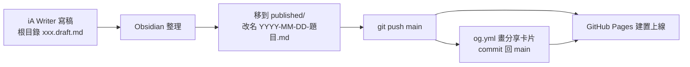
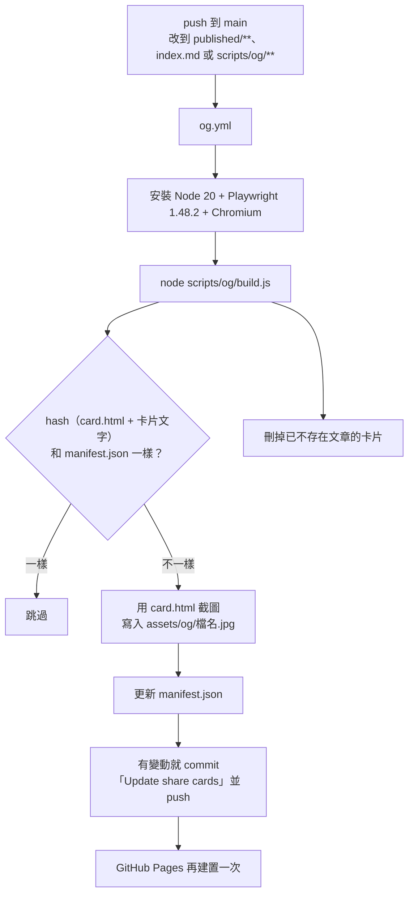
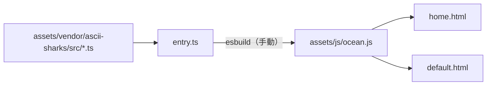

# laiyenju.github.io

Yen Lai 的個人網站：<https://laiyenju.github.io>

- 純 Jekyll，由 GitHub Pages 建置（`main` 分支、根目錄）。沒有主題，沒有外掛，沒有 `Gemfile`。
- 只有兩個自動流程：**GitHub Pages 建置網站**、**GitHub Action 畫分享卡片**。
- 只有一個手動步驟：改了錦鯉原始碼（`assets/vendor/ascii-sharks/src/`）之後，要重新打包 `assets/js/ocean.js`。

---

## 1. 資料夾結構

| 資料夾／檔案 | 處理什麼 |
|---|---|
| `published/` | 已發布的文章。放進這裡就是發布 |
| 根目錄 `*.draft.md` | 草稿，不會上線 |
| `index.md`、`_layouts/home.html` | 首頁。notes 和 works 也是首頁的一部分（`?view=notes`、`?view=works`） |
| `_layouts/default.html` | 文章頁 |
| `_includes/` | 每頁共用的 `<head>`、SEO 標籤、日夜主題與介面語言的初始設定 |
| `_data/works.yml` | works 清單 |
| `_config.yml` | 網站資訊、哪些檔案要建置 |
| `assets/css/`、`assets/js/` | 全站樣式和互動（日夜切換、terminal 介面、文章頁效果） |
| `assets/vendor/ascii-sharks/` | 錦鯉引擎的 TypeScript 原始碼，打包成 `assets/js/ocean.js` |
| `assets/og/`、`scripts/og/`、`.github/workflows/og.yml` | 分享卡片：圖檔、產生程式、自動執行的 Action |
| `assets/icons/`、`assets/fonts/`、`assets/images/` | favicon、文章字型、文章圖片 |
| `notes/`、`works/`、`sitemap.xml`、`robots.txt` | 舊網址轉址、給搜尋引擎的檔案 |

### 注意事項

| 項目 | 說明 |
|---|---|
| `assets/js/ocean.js` | 打包產生的檔案，不要直接改。改 `assets/vendor/ascii-sharks/src/` 後重新打包（見 3.3） |
| `assets/og/` | Action 自動產生並 commit，不要手動改或刪 |
| 不會上線的檔案 | `*.draft.md`、`README.md`、`scripts/`、`assets/vendor/`、`assets/og/manifest.json`（`_config.yml` 的 `exclude`） |
| 文章網址 | `published/2026-10-29-題目.md` → `/published/2026-10-29-題目.html`。改檔名會改網址，舊連結會失效 |

---

## 2. 可以調整的設定

只列出要自己動手改的設定。字數、sitemap、分享卡片這些會自動產生，不用管。

### 2.1 網站資訊：`_config.yml`

| 設定 | 預設 | 說明 |
|---|---|---|
| `title` | `Yen Lai` | 文章頁標題的後半段（「標題 · Yen Lai」） |
| `description` | 一句英文 + 一句中文 | 首頁的搜尋摘要 |
| `url` | `https://laiyenju.github.io` | 換網域時要改 |
| `author.name` | `Yen Lai` | 結構化資料的作者 |
| `author.twitter` | `theYenLai` | X 分享卡片的帳號 |
| `og_image` | `/assets/og/home.jpg` | 沒有自己卡片的頁面用這張 |
| `lang` | `zh-Hant` | 頁面語言。單一頁面可以在 front matter 用 `lang` 覆蓋（首頁是 `en`） |

### 2.2 文章：front matter

| 欄位 | 必填 | 預設 | 說明 |
|---|---|---|---|
| `title` | 是 | — | 標題 |
| `date` | 是 | — | 格式 `YYYY-MM-DD`。決定排序；`total` 字數只算今年的文章 |
| `description` | 否 | 內文前 120 字 | 搜尋摘要，也是分享卡片上的摘要 |
| `lang` | 否 | `zh-Hant` | 英文文章填 `en` |

### 2.3 works 清單：`_data/works.yml`

每一項是一筆，目前是空的 `[]`：

```yaml
- title: 專案名稱
  one_liner: 一句話說明
  status: in progress
  url: https://…        # 選填；沒填時點了不會跳頁
```

| 欄位 | 選項 | 說明 |
|---|---|---|
| `status` | `in progress` → ●（強調色）、`experiment` → ◐、其他值或不填 → ○ | 字會照原樣顯示 |

### 2.4 首頁內容

| 設定 | 位置 | 預設 | 注意 |
|---|---|---|---|
| 名字、職稱、slogan | `_layouts/home.html` | `hey, I'm Yen`／`Product manager @Taiwan`／`I write about how products get decided.` | `whoami` 的回應在 `assets/js/shell.js`、`assets/js/post.js`；首頁分享卡片文字在 `scripts/og/build.js`，要一起改 |
| 社群連結 | `_layouts/home.html` | github、linkedin、x | `_includes/seo.html` 的 `sameAs` 要一起改 |
| 瀏覽器分頁標題 | `assets/js/home.js` 的 `TITLES` | `hey, I'm Yen`／`Notes · Yen`／`Works · Yen` | 首頁的要和 `index.md` 的 `title` 一樣 |
| 清單一次顯示幾篇 | `assets/js/home.js` 的 `LIST_LIMIT` | `6` | 超過的收進 `view all` |

### 2.5 外觀

| 設定 | 位置 | 預設 | 其他選項／注意 |
|---|---|---|---|
| 日夜主題 | 讀者自己選（首頁右上角） | `auto`（跟隨系統） | `day`、`night`。存在讀者的瀏覽器裡 |
| 強調色 | `assets/css/site.css`：日間 `:root` 的 `--accent`，夜間 `body.theme-night` 的 `--accent` | 日間 `#b5531e`（朱）、夜間 `#f5b942`（琥珀） | 文章頁另有 `--shu`（`.post-prose`），分享卡片在 `scripts/og/card.html`，要一起改 |
| 底色 | `assets/css/site.css` | 日間 `#fafaf7`、夜間 `#0d0f12` | 夜間色寫在多條規則裡，要全文搜尋取代。`seo.html` 的 `theme-color`、`notes/index.md`、`works/index.md`、`card.html` 也有 |
| 錦鯉樣式 | `_layouts/home.html`、`assets/js/post.js` 的 `OceanEngine(…)` | 日間 `GLYPH_DAY`（明體倉頡字根）、夜間 `GLYPH_NIGHT`（點陣字根） | `ASCII`（原版英數字元）。改 `src/themes.ts` 的字元要重新打包；改了 `RADICALS` 要更新 `_includes/head.html` 的 Google Fonts `text=` 清單 |
| 網頁字型 | `_includes/head.html`（Google Fonts） | JetBrains Mono、Noto Sans TC | 文章內文是 iA Writer Quattro（`assets/fonts/quattro/`） |
| 註腳放側欄的最小寬度 | `assets/js/post.js` 的 `RAIL_MIN` | `1088`（px） | 較窄時放文末。要和 `site.css` 的文章欄寬（680px）一起算 |
| 點文章時的捲動速度 | `assets/js/shell.js` 的 `LINE`、`TICK` | `30`（px）、`24`（ms） | `LINE` 越大、`TICK` 越小越快 |

### 2.6 介面語言

沒有設定可以改：瀏覽器第一語言是中文就顯示中文，其他顯示英文。新增介面文字時，兩種語言都要寫：

| 位置 | 寫法 |
|---|---|
| HTML | `<span class="i-en">…</span><span class="i-zh">…</span>` |
| JS | `t("English", "中文")` |
| `aria-label`／`title` | 預設寫英文，中文寫在 `data-label-zh`／`data-title-zh` |

---

## 3. 流程

### 3.1 寫作與發布



1. 草稿放在根目錄，檔名結尾是 `.draft.md`，不會上線。
2. 發布 = 把檔案移進 `published/`，檔名用 `YYYY-MM-DD-題目.md`。
3. 寫好 front matter（見 2.2）。
4. `git push` 到 `main`，其他都是自動的。

文章網址的規則：`published/2026-10-29-markdown-styles.md` → `/published/2026-10-29-markdown-styles.html`。notes 清單上顯示的檔名會去掉日期（`markdown-styles.md`）。

### 3.2 分享卡片（自動）



- 改了 `card.html`，所有卡片都會重畫。新文章的卡片產生前，先用 `home.jpg`。
- 也可以在 GitHub → Actions → Share cards → **Run workflow** 手動執行。
- 本機執行：

  ```bash
  npm install --no-save playwright && npx playwright install chromium && node scripts/og/build.js
  ```

### 3.3 錦鯉引擎（手動打包）



改了 `src/` 或 `entry.ts` 之後，執行下面的指令，再把 `ocean.js` 一起 commit：

```bash
npx esbuild@0.24.0 assets/vendor/ascii-sharks/entry.ts --bundle --format=iife --target=es2019 --outfile=assets/js/ocean.js
```

### 3.4 本機預覽

```bash
jekyll serve
```

輸出在 `_site/`（已在 `.gitignore`）。

---

## 4. 待處理

| # | 項目 | 狀況 | 建議 |
|---|------|------|------|
| 1 | `published/2026-03-08-hello.md` | 範例文章，已公開上線、在 sitemap 裡 | 第一篇正式文章上線後刪除 |
| 2 | `published/2026-10-29-markdown-styles.md` + `assets/images/markdown-sample.svg` | 樣式測試頁，也公開上線 | 想保留當測試頁，可移到根目錄改成 `.draft.md`（但本機預覽就看不到）；或加 front matter `sitemap: false`，並在 `sitemap.xml`、首頁 notes 清單加條件排除 |
