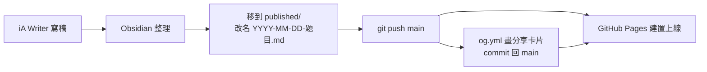
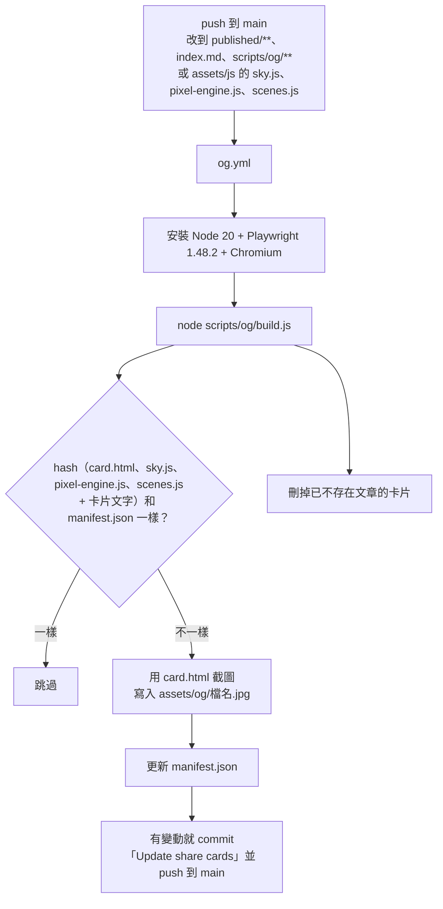
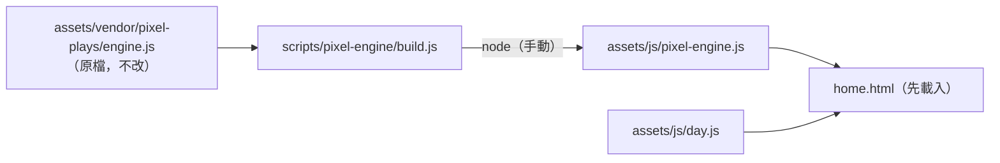
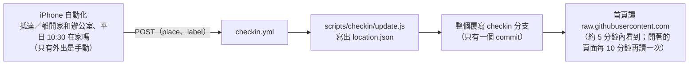

# laiyenju.github.io

Yen Lai 的個人網站：<https://laiyenju.github.io>

- 純 Jekyll，由 GitHub Pages 建置（`main` 分支、根目錄）。沒有主題，沒有外掛，沒有 `Gemfile`。
- 只有三個自動流程：**GitHub Pages 建置網站**、**GitHub Action 畫分享卡片**、**GitHub Action 記錄打卡**。
- 只有一個手動步驟：改了 pixel 引擎（`assets/vendor/pixel-plays/engine.js`）或 `scripts/pixel-engine/build.js` 之後，要重新產生 `assets/js/pixel-engine.js`（見 3.3）。

---

## 1. 資料夾結構

| 資料夾／檔案 | 處理什麼 |
|---|---|
| `published/` | 已發布的文章。放進這裡就是發布 |
| `index.md`、`_layouts/home.html` | 首頁：每天一棟 pixel 建築、Timeline、下方的 terminal（notes、works 都在 terminal 裡）。`home.html` 把文章清單和 `_data/` 的資料寫成 JSON 放進頁面，畫面全部由 `assets/js/day.js` 畫出來 |
| `_layouts/default.html` | 文章頁。從首頁的 notes 清單打開時，這一頁整頁放進首頁的閱讀畫面（和作品頁同一個，見下面 `notes/`、`works/`）；從外部連結打開時才自己顯示。框架和作品頁一樣：頂部是日期卡片，按鈕和卡片分開（左邊 `← Notes` 連到 `/?view=notes`，右邊 Home；時間由 `assets/js/post.js` 的 `tick` 填），下面直接是靠左的標題（和卡片之間留一段空白，作品頁一樣），文末是 `(END)`。放在首頁裡時（`html.post-embed`）不顯示自己的卡片，用首頁的 |
| `_includes/` | 每頁共用的 `<head>`、SEO 標籤。文章頁的天色在 `head.html` 裡就先套上（`body` 出現之前），第一個畫面就是天色，從首頁點進來不會先閃一下白色；`theme-boot.html` 再加上夜晚的淺色字和介面語言 |
| `_data/works.yml` | 作品集（terminal 的 `ls works`，每件作品一頁 `#work-<slug>`） |
| `_data/days.yml` | 去過的地方：首頁的往年今日建築、Timeline 的每一天 |
| `_data/little.yml` | 小事（例如散步遇到柴犬），在今天的建築旁出現一週 |
| `_config.yml` | 網站資訊、哪些檔案要建置 |
| `assets/css/`、`assets/js/` | 兩邊共用：`sky.js`（所在城市、太陽位置、依太陽決定的背景顏色）。首頁：`day.css`、`day.js`（Timeline、terminal、版面）、`scenes.js`（建築模型 `SCENES`、光線、影子和窗燈，分享卡片也用它）、`pixel-engine.js`（產生的檔案）。文章頁：`site.css`、`theme.js`（每分鐘跟著天色更新）、`post.js`。Markdown 樣式在 `site.css` 的 `.post-prose`；文章圖片排版和點開放大在 `assets/js/post.js`（`buildFigures`、`buildLightbox`）和 `site.css` 的 `.post-fig`、`.post-gallery`、`.lb` |
| `assets/vendor/pixel-plays/`、`scripts/pixel-engine/` | Pixel Plays 引擎原檔（MIT，作者 AmirMushich，`LICENSE` 在同一個資料夾）和把它轉成 `assets/js/pixel-engine.js` 的程式 |
| `assets/og/`、`scripts/og/`、`.github/workflows/og.yml` | 分享卡片：圖檔、產生程式、自動執行的 Action。卡片是一張明信片：左邊是那篇筆記當天的建築，像 Timeline 一樣只有建築、沒有影子，盡量放大，底色是由上往下淡出的暖色天空（網站太陽約 8° 時的顏色）。建築的選法：那天在 `_data/days.yml` 有地點就用那個地點，下面寫名稱、城市・國家、經緯度（`coords`）；沒有就照日曆：平日辦公室，週末和 `HOLIDAYS` 是家（卡片不看打卡），下面寫 The office／Home 和 Taipei · Taiwan。右邊是郵戳（城市、日期、星期）、`cat notes/<檔名>`、標題、副標題（沒有就用摘要）和寄件地址，沒有郵票。首頁的卡片是辦公室，郵戳不寫日期（`scripts/og/card.html`，地點由 `scripts/og/build.js` 的 `places` 讀 `days.yml`） |
| `.github/workflows/checkin.yml`、`scripts/checkin/`、`checkin` 分支 | 打卡：iPhone 捷徑觸發 Action，`scripts/checkin/update.js` 寫出 `location.json`，放在 `checkin` 分支；首頁讀它決定今天的建築和「Where is Yen now」（見 3.5）。外出時要當成今天的建築：附近有模型的地點由 `scripts/checkin/day.js` 在 `_data/days.yml` 加上今天、commit 到 `main`；其他地點開一個 issue 給 Claude（見 3.6） |
| `assets/icons/`、`assets/fonts/`、`assets/images/` | favicon、文章字型、文章圖片 |
| `notes/`、`works/` | `/notes/`、`/works/` 網址轉到首頁的 `?view=notes`、`?view=works`，首頁會捲到 terminal 並執行 `ls notes`／`ls works`。notes 直接用作品的那一套，沒有另外的程式：清單裡點一篇（`open notes/<檔名>`、`open works/<slug>`），在首頁的閱讀畫面打開（`#note-<檔名>`、`#work-<slug>`，`day.js` 的 `openNote`、`openWork`），同樣的卡片和按鈕（`← Notes`／`← Work`、Home），同樣的回清單方式（`backToList`：從清單打開的就關掉、把清單捲回日期卡片下方、剛讀的那一列反白再退掉；從連結打開的就執行一次 `ls notes`／`ls works`），Home 和 Esc 回到乾淨的首頁。文章的內容是文章頁本身，整頁放在閱讀畫面裡（`iframe`），所以文章的樣式只有 `site.css` 一份；放在裡面時，文章裡的連結開在整個視窗、Esc 和放大圖片會通知首頁（`post.js` 的 `EMBED`、`tellHome`）。清單的列也是連結：⌘／Ctrl 點或中鍵點，會在新分頁打開文章頁本身 |
| `sitemap.xml`、`robots.txt` | 給搜尋引擎的檔案 |
| `CLAUDE.md` | 給 Claude 的工作規則（例如：改檔案時要同時更新 README） |

### 注意事項

| 項目 | 說明 |
|---|---|
| `assets/js/pixel-engine.js` | 產生的檔案，不要直接改。改 `assets/vendor/pixel-plays/engine.js` 或 `scripts/pixel-engine/build.js` 後重新產生（見 3.3） |
| 首頁網址 | `#timeline`、`#day-YYYY-MM-DD`（Timeline 停在那天；同一天第二棟以後加 `-2`、`-3`）、`#past-YYYY-MM-DD`（和首頁同一個畫面，只是主建築換成那天的，標題上方有一行主題色的「幾年前・日期」（`day.css` 的 `.past-tag`）；頂部按鈕寫 Today，點了回到今天；點建築打開 Timeline 的那一天）、`#work-<slug>`（一件作品）、`#note-<檔名>`（一篇文章，例如 `#note-2026-10-29-markdown-styles`）。分享這些網址會直接打開那個畫面 |
| 日期卡片 | 頂部是一行，像 terminal 的標題列，置中、最寬 440px（寬螢幕上按鈕才不會離時間太遠，看起來是一組；手機上左右各留 20px，和作品、文章的內文對齊）：左邊回清單（`← Work`／`← Notes`，只在作品和文章），中間是時間，右邊的按鈕寫的是現在所在的畫面：今天的首頁是 Today（點了打開 Timeline）、Timeline 裡是 Timeline（點了回到今天）、過去某天的首頁是 Today（點了回到今天）；在作品和文章是 Home（只有圖示）。時間沒有框，只是字。這一行底下是一條天色的帶子、往下淡出，捲動時內容不會撞到字（首頁 `_layouts/home.html` 的 `.top-row`、`day.css` 的 `.top`；文章頁 `_layouts/default.html` 的 `.post-row`、`site.css` 的 `.post-top`）。離頂端 `--card-top`：手機 12px；寬螢幕（≥ 900px）是畫面高度的 9%（28–96px）；在 `day.css` 和 `site.css` 各有一份，要一起改。時間有兩行，字級每一頁都一樣：上面一行 `--card-title`（15px），下面一行 `--card-sub`（12px），也是兩份要一起改。首頁、作品頁和文章頁：上面是現在的時間，到秒（`HH:MM:SS`），下面是台北今天的星期（`Fri`；首頁 `day.js` 的 `todayWd`，文章頁 `post.js` 的 `tick`）。時間的每個數字像翻牌一樣往上捲到下一個（`assets/js/sky.js` 的 `rollClock`，首頁由 `day.js` 的 `secondTick`、文章頁由 `post.js` 的 `tick` 每秒呼叫；樣式在 `day.css`、`site.css` 的 `.roll`；系統設定「減少動態效果」時直接換數字）。Timeline 裡上面一行改成那天的日期（數字像轉盤一樣轉到那天），下面是「幾年前」（`Seven years ago`；今年稍早的日子寫 `This year`，今天那一筆寫 `Today`），不顯示時間；進出 Timeline 時不消失：時間和日期疊在同一個位置交叉淡入淡出（淡出的那個稍微變模糊，重疊的瞬間才不會亂；淡入的日期直接停在那天，不從 0 轉起），下面一行也一樣；在 Timeline 裡換一天時，下面一行同樣交叉淡入淡出（`day.js` 的 `dialTo`、`day.css` 的 `.when .face`）；停在過去某一天時，日期和這一行用強調色（`day.css` 的 `.when.is-past-day`）。按鈕的切換在 `day.js` 的 `ctaFor` |
| `assets/og/` | Action 自動產生並 commit，不要手動改或刪 |
| `checkin` 分支 | Action 每次打卡都整個覆寫，只有一個 commit、一個 `location.json`。不要手動改，也不要合併進 `main` |
| 打卡寫進 `main` 的 commit | 外出時在已有模型的地點選「當成今天的建築」，Action 會直接 commit「Today at …（check-in）」到 `main`（改 `_data/days.yml`）。本機改東西前先 `git pull` |
| 草稿 | repo 裡目前沒有草稿。要把草稿放進 repo，就放在根目錄，檔名結尾用 `.draft.md`，不會上線 |
| 不會上線的檔案 | 根目錄的 `*.draft.md`、`README.md`、`CLAUDE.md`、`scripts/`、`assets/vendor/`、`assets/og/manifest.json`（`_config.yml` 的 `exclude`） |
| 文章網址 | `published/2026-10-29-題目.md` → `/published/2026-10-29-題目.html`。改檔名會改網址，舊連結會失效 |

---

## 2. 可以調整的設定

只列出要自己動手改的設定。字數、sitemap、分享卡片這些會自動產生，不用管。

### 2.1 網站資訊：`_config.yml`

| 設定 | 預設 | 說明 |
|---|---|---|
| `title` | `Yen Lai` | 文章頁標題的後半段（「標題 · Yen Lai」） |
| `description` | 一句英文 + 一句中文 | 首頁的搜尋摘要。英文那句和自我介紹（2.4 的 `BIO`）說同一件事 |
| `url` | `https://laiyenju.github.io` | 換網域時要改 |
| `author.name` | `Yen Lai` | 結構化資料的作者 |
| `author.twitter` | `theYenLai` | X 分享卡片的帳號 |
| `og_image` | `/assets/og/home.jpg` | 文章的卡片還沒產生時，先用這張 |
| `lang` | `zh-Hant` | 頁面語言。單一頁面可以在 front matter 用 `lang` 覆蓋（`index.md` 設成 `en`） |

### 2.2 文章：front matter

| 欄位 | 必填 | 預設 | 說明 |
|---|---|---|---|
| `title` | 是 | — | 標題 |
| `subtitle` | 否 | 無 | 副標題，顯示在標題下方，也是首頁 terminal `ls notes` 清單裡標題下面那一行。不填就沒有這一行（清單改用 `description`，也沒有就只顯示標題） |
| `date` | 是 | — | 格式 `YYYY-MM-DD`。決定排序和顯示的日期（不是看檔名的日期）；`total` 字數只算今年的文章 |
| `description` | 否 | 內文前 120 字 | 搜尋摘要，也是分享卡片上的摘要 |
| `lang` | 否 | `zh-Hant` | 英文文章填 `en`，會改 `<html lang>` 和 `og:locale`。結構化資料的語言固定是 `zh-Hant`（`_includes/seo.html`） |

### 2.3 作品集：`_data/works.yml`

一件作品一筆，terminal 的 `ls works` 依檔案順序列出，點了打開那件作品的頁面（`#work-<slug>`）：

```yaml
- slug: design-lint          # 網址用，英文小寫和 -
  year: "2026"               # 文字，可以寫 "2024–25"
  title: Design Lint
  sub: 一句話說明
  role: Design and build
  problem: 當時的問題
  did: Yen 做了什麼
  result: 結果
  url: https://…             # 選填；只放公開的頁面，私人 repo 不要放
  url_label: open the presentation   # 選填，連結文字，預設 open the portfolio
```

全部用英文寫（網站介面一律英文，只有文章可以是中文）。

### 2.3.1 去過的地方：`_data/days.yml`

一筆是一天、一棟建築。建築底下每件事只說一次：上面一行主題色的「幾年前・日期」（從 `date` 算，`day.js` 的 `whenTag`）、名稱、地點（Google Maps 連結，`placeFor`），最後一句由同一條規則組出來：`Yen {did}[ with {with}].[ {extra}]`（`sentenceFor`）。所以 `did` 只寫發生了什麼，不寫時間、地點，也不要再寫一次建築名稱（標題已經有）

| 欄位 | 必填 | 說明 |
|---|---|---|
| `date` | 是 | `"YYYY-MM-DD"`，要加引號。同一天可以有好幾筆（好幾棟建築），網址會依順序變成 `#day-2019-01-26`、`#day-2019-01-26-2`… |
| `scene` | 是 | 建築模型的名字，要先在 `assets/js/scenes.js` 的 `SCENES` 裡有這個模型。目前有：`studio`（工作地點：富邦遼寧大樓）、`home`（家：剖開的兩層鋁板盒子，看得到室內）、`itsukushima`、`naoshima`、`grandcentral`、`unitednations`、`google`、`highline`、`whitney`、`nyt`、`capitol`、`whitehouse`、`washington`、`lincoln`、`mbc`、`hongik`、`nanshan`（微風南山） |
| `name` | 是 | 英文名稱 |
| `zh` | 是 | 中文名稱。不要中文時改寫 `no_zh: true` |
| `place` | 是 | 城市或地區，例如 `Sangam, Seoul`，會變成 Google Maps 連結 |
| `did` | 是 | Yen 做了什麼，小寫開頭、不加句號 |
| `with` | 否 | 同行者，一個人或一串 `[Mei, Ken]` |
| `extra` | 否 | 補充一句 |
| `map` | 否 | Google Maps 搜尋文字，預設用 `name, place` |
| `country` | 否 | 預設 `Japan`。Timeline 的國家數由它算 |
| `coords` | 否 | `[緯度, 經度]`，例如 `[40.7527, -73.9772]`。那天寫的筆記，分享卡片上會印出來；外出打卡也靠它認出這個地點（150 m 內，見 3.6），沒有 `coords` 的地點認不出來 |

缺必填欄位、沒有中文名、或模型不存在時，那一筆不會出現，瀏覽器的 console 會列出缺了什麼。

### 2.3.2 小事：`_data/little.yml`

```yaml
- date: "2026-11-02"
  kind: shiba               # 模型畫得出來的：shiba
  text: Yen met a Shiba Inu on a walk this week.
```

從 `date` 起七天內，今天的建築旁會出現這個角色，句子接在自我介紹後面。

### 2.4 首頁內容

| 設定 | 位置 | 預設 | 注意 |
|---|---|---|---|
| 自我介紹 | `assets/js/day.js` 的 `BIO` | `Yen decides what gets built, then builds some of it. Writes about how those decisions get made.` | 今天的建築底下用它；terminal 的 `whoami` 把開頭的 Yen 換成「Yen Lai, product manager,」。一起改：首頁分享卡片文字（`scripts/og/build.js`，卡片上用第一人稱「I decide…」；push 後 Action 會重畫卡片）、首頁搜尋摘要（`_config.yml` 的 `description`）、職稱（`_includes/seo.html` 的 `jobTitle`） |
| 社群連結 | `assets/js/day.js` 的 `whoami` | github、linkedin、x | 首頁不直接放連結，要執行 `whoami` 才看得到。一起改：`_includes/seo.html` 的 `sameAs`；X 帳號另有 `_config.yml` 的 `author.twitter` |
| 今天的建築（家／辦公室） | `assets/js/day.js` 的 `todayPlace`、`todayScene`；固定日期的假日在 `assets/js/scenes.js` 的 `HOLIDAYS` | 0. `_data/days.yml` 有今天日期的地方 → 那棟建築，底下是它的名稱、地點和句子（同一天有好幾筆時用最後一筆；隔天起它就出現在 Timeline）。1. 今天在辦公室打過卡 → 辦公室（週末補班也是）。2. 週末和 `HOLIDAYS`（元旦、228、兒童節、勞動節、教師節、國慶、光復節、行憲紀念日）→ 家。3. 平日在上班時間（09:00–18:30，`OFFICE_HOURS`）打過「家」→ 家（請假或在家工作）。4. 其他平日：整天都是辦公室，晚上回家打卡不會變成家 | 建築是「今天在哪裡過」，「現在在哪」看 Where's Yen。農曆假日、請假、補班都不用改程式，也不用手動：平日 10:30 的自動化「打卡：在家嗎」看到手機在家，就打一次「家」；休假日在 10:30 之前會先顯示辦公室（見 3.5 步驟 5）。分享卡片不看打卡，只照週末和 `HOLIDAYS` |
| 所在城市 | `assets/js/sky.js` 的 `CITY` | 台北（緯度、經度、時區 +8） | 決定頂部時間、首頁和文章頁的背景顏色、影子方向。出國時只要改這裡，首頁和文章頁的時間都會跟著變 |
| 「Where is Yen now」的作息 | `assets/js/day.js` 的 `WEEKDAY`、`RESTDAY` | 平日：00–07 asleep、07–09 on the way to the office、09–12 at the office、12–13:30 lunch、13:30–18:30 at the office、18:30–19:30 on the way home、之後 at home；假日另一張表 | 6 小時內的打卡優先（`CHECKIN_FRESH`），說「Yen is {label}, Taipei. Checked in at HH:MM.」；離開家、離開辦公室這種在路上的打卡只算 90 分鐘（`TRANSIT_FRESH`），漏了抵達也不會整晚說在路上。今天是辦公室日時，離開家說「on the way to the office」。沒有有效的打卡才用作息表。今天是家的日子就用假日那張表 |
| terminal 按鈕 | `assets/js/day.js` 的 `CHIPS`、`placeBar`；樣式在 `assets/css/day.css` 的 `.cmdbar` | `❯`、About Yen、Notes、Work、Where's Yen、Clear | 整個首頁只有這一排。寬螢幕（≥ 900px）：一開始在今天的說明下面、置中（`_layouts/home.html` 的 `#barSlot`；按鈕移走時這裡仍留著空間，版面不跳），往下捲到 terminal 時滑進 terminal、貼在輸入框下面（輸出很長時貼在畫面底部），捲回去再滑回來。手機：一直固定在畫面底部。沒有分隔線；按鈕和頂部的按鈕同一種樣子（見 2.5「按鈕」），底下是一條天色的帶子、往上淡出，捲過去的內容不會撞到字。只在 Timeline、作品頁、文章打開時隱藏。點了分三拍：先把這一行捲到日期卡片正下方（不會被卡片擋住）、停穩，再帶著游標一個字一個字打出指令、停一下像按了 Enter，最後輸出一列一列淡入；打字和輸出的這段時間，空的輸入框和這排按鈕先隱藏，輸出出來後才淡入回來，畫面上一次只有一件事（`day.js` 的 `run` 的 `term-busy`、`day.css` 的 `body.term-busy`）（`day.js` 的 `run`、`focusLine`、`reveal`；頁面不夠長時 terminal 下方會自動留白；系統設定「減少動態效果」時直接顯示）。清單裡點一列（`open works/…`、`open notes/…`）會立刻打開，不打字；點 `❯` 也會把輸入框捲到那裡。放不下時可以左右滑，右邊會淡出提示。可輸入的指令在 `COMMANDS`。`clear` 會清空 terminal 並捲回頂端（在 `run` 裡）。terminal 一開始是收起來的：只有這排按鈕，沒有輸入框、下方也不留空間，首頁不能往下捲進 terminal（手機、寬螢幕都一樣；`day.css` 的 `.term:not(.on)`）。點了按鈕、`❯` 或按 `/` 才打開（`day.js` 的 `openTerm`），`clear` 捲回頂端後再收起來（`clearTerm`）。寬螢幕上按鈕滑進 terminal 後，`❯` 和輸入框的 `❯` 對齊（`.term .cmdbar .arrow` 往左拉回按鈕的內距）。從其他畫面回到首頁（離開 Timeline、作品頁或文章按 Home 或 Esc、離開往年今日）時 terminal 一律清空（`day.js` 的 `clearTerm`）；只有回到清單（從清單打開後按 `← Work`、`← Notes` 或瀏覽器上一頁）會保留清單 |
| 瀏覽器分頁標題 | `index.md` 的 `title` | `hey, I'm Yen` | |

### 2.5 外觀

| 設定 | 位置 | 預設 | 其他選項／注意 |
|---|---|---|---|
| 首頁和文章頁顏色 | `assets/js/sky.js` 的 `BG_STOPS`（背景）、`TEXT`（文字原本的顏色）、`colours`；首頁的光線和窗燈在 `scenes.js` 的 `lightFor` | 跟著 `CITY` 的真實太陽高度變：白天接近白、黃昏暖色、夜晚深藍。晚上每棟建築都有光：窗戶亮燈（`api.emissive`，辦公大樓約兩成樓層不亮），紀念建築和鳥居打燈（`api.emissive(…, 'flood')`，保留白天的顏色、偏暖）。整個網站沒有日夜切換，只有這一條規則 | 每一種文字顏色（內文、副標、日期與提示、強調色）都先用 `TEXT` 的顏色，讀不清楚時才往深或淺移一點，對比至少 4.5。黃昏的中間色也會稍微調深或調淺。程式碼區塊和行內程式碼的底色是「天色加一點文字色」（`site.css` 的 `--washi`），任何時間都看得出邊界 |
| 首頁字級 | `assets/css/day.css` 的 `.caption .name`、`.caption .note`、`.when b` | 今天的標題和底下的說明同一個字級：21px（行高 1.5），標題只是粗體，說明和標題之間多 10px，讓第一個畫面單純；頂部卡片：上面一行 15px、下面一行 12px，每一頁都一樣（`--card-title`、`--card-sub`，見「日期卡片」） | |
| 按鈕 | `assets/css/day.css` 的 `.top-btn, .cmdbar button`、`--press-soft`；文章頁 `site.css` 的 `.post-btn` | 全站只有一種按鈕，從 terminal 清單的選取（`.ls .lit`）來：等寬字（13px），平常沒有框、沒有底色；滑鼠指到時後面有一塊很淡的文字色（7%，只在有滑鼠的裝置上，手機點過不會留著）；按下去整塊反白（文字色底、天色字、直角），左右比字多出 10px；用鍵盤移到按鈕上是一圈強調色的直角框。文章頁的按鈕是連結（`<a>`），`site.css` 的 `.post-btn` 另外蓋掉手機點擊的灰色閃光和連結的底線、變色，每個狀態都和首頁一樣。頂部的按鈕、terminal 那排按鈕、清單的列都是這個樣子。只用文字色和天色，`sky.js` 保證文字色在任何天色上都讀得清楚，所以不用為不同時間另外調 | 只能看的東西（時間）也沒有框。`❯` 用強調色 |
| 建築大小 | `assets/js/day.js` 的 `sizeStage`、`homeScale`（`fitCanvas`）、`tlScale`（`fitTl`）、`TL_K`、`wholePixels` | 首頁的建築一律盡量大，讓會動的細節看得清楚：框裡放到 `* .97`，最多 4.4 倍。寬螢幕：和手機一樣上下排：建築、說明和按鈕（置中），建築框最寬 900px，高度是畫面扣掉日期卡片那一列、說明和下方 32px 剩下的（260–760px），建築和說明在卡片下方的空間裡上下置中。手機：建築框是畫面高度的六成，但不超過畫面寬度的 1.25 倍（手機上建築被寬度限制，再高只會在卡片下面多出空白），不會因為有往年縮圖或說明比較長而縮小（放不下的說明往下捲就看得到）；說明放得下、還有空間時平均分到上下，讓建築和說明靠在一起、整組置中。Timeline：不論手機或電腦，都是首頁同一棟建築的 `TL_K`（0.85）倍，框也是首頁的框縮成 0.85 倍、從同一個頂端開始（`day.css` 的 `--tl-k`，由 `TL_K` 設定），所以進 Timeline 時建築往上方稍微縮小，和日期卡片之間的空白不會變大。畫素一律取整數倍螢幕像素（`wholePixels`，不會因此變小超過兩成）；Timeline 取整數後若不在首頁大小的 75%–90% 之間，就直接用 0.85 倍。沒有往年今日時，縮圖那一列會收起來（`day.css` 的 `.tools:has(.thumbs.none)`）
| 家的建築 | `assets/js/scenes.js` 的 `SCENES.home`；書牆在 `bookWall`、天窗玻璃在 `glassPane`、行道樹位置在 `HOME_TREES` | 兩層的鋁板盒子，首頁看得到的兩面（+x、+y）剖開，看得到室內：左後牆是兩層高的書牆，右後方 2 樓是閣樓（閱讀角），1 樓是長桌（工作兼吃飯）、廚房和沙發，書牆上方是玻璃天窗。書牆一開始就放滿灰色的書、盆栽、黑膠和花瓶；每篇筆記（`published/` 的文章數）把一本灰書換成一本彩色的書，從最上層的左邊開始（顏色依序用 `NOTE_BOOKS`，灰書的顏色在 `PLAIN_BOOKS`）。晚上室內保持亮著（`'flood'`），吊燈、立燈和筆電螢幕發光。家裡一直有一隻柴犬（沿著 `HOME_WALK` 繞一圈：書牆前、走出去人行道、再從長桌旁走回來）和一隻黑白貓（坐在沙發椅背上，尾巴會掃、偶爾轉頭；每 24 秒會沿著椅背走到另一頭再坐下，走回來也一樣；`cat`、`catWalking`、`catOnSofa`），Timeline 的靜止版沒有 | 換書的顏色改 `NOTE_BOOKS`；書架的格數由 `bookWall` 的 `rows`（8）和每格寬約 0.72 決定，最上層大約放得下 50 本，之後才換到第二層 |
| 建築下面的地 | `assets/js/day.js` 的 `PLATE`、`plateFor`、`placePlate`；首頁說明上方留給它的空間在 `day.css` 的 `.caption` 的 `padding-top`（24px） | 首頁上，本身沒有地面的模型（`bare`，目前除了 `home` 都是）站在一塊淡淡的等距地磚平台上，不再飄浮：大小照建築貼地的範圍（`plateFor` 只算碰到地面的像素，拱門下方、屋頂、旗子不算），四周多 0.6 格，每格約 1 單位，前面兩側有一點厚度。顏色是頁面的文字色、很淡（`PLATE` 的 `top`、`line`、`right`、`left` 是透明度），所以跟著天色變。影子畫在建築的圖上，會落在地磚上。`home` 有自己的人行道和草地，不加 | 進 Timeline 時，地磚往建築的中心收進去，越收越快，像被吸塵器吸進去，中心跟著建築移到 Timeline 裡的位置（`suckPlate`，約 0.38 秒）；回到首頁時，等建築落定後再從中心鋪開（`unrollPlate`，0.42 秒）。Timeline 裡沒有地磚。系統設定「減少動態效果」時直接出現、消失 |
| 首頁才會動的細節 | `assets/js/scenes.js` 的 `e.moving`（`flag`、`usFlag`、`krFlag`、`birds`、`ripples`、`beacon`） | 旗子飄、樹和植物搖、鳥繞著飛、水面波紋、噴泉、屋頂紅色警示燈閃。只在首頁動，Timeline 裡同一棟建築是靜止的，用來分辨現在在哪一頁 | 新模型要加會動的東西，在 `build` 裡用 `e.moving((e, t) => …)`；`t` 是 `null` 時畫靜止的樣子（Timeline）。系統設定「減少動態效果」時不動 |
| 建築的邊緣 | `assets/js/scenes.js` 的 `getWorld`、`cleanShadow`，`day.js` 的 `wholePixels` | 沒有地面的模型（`bare`）不畫地面的陰暗邊（`bakeOcclusion`），影子邊緣整理成一條乾淨的線；畫面縮放取整數倍螢幕像素 | 避免建築四周出現像去背沒去乾淨的灰點 |
| Timeline 的動畫 | `assets/js/day.js` 的 `buildUp`（一磚一磚，磚塊 4×3 像素）、`dissolve`、`MOVE` | 蓋起來 0.9 秒、溶解 0.2 秒、首頁和 Timeline 之間移動 0.48 秒（建築往上方稍微縮小；地磚跟著建築收進它的中心、回來時再鋪開，見「建築下面的地」） | 系統設定「減少動態效果」時都直接跳到結果 |
| 頁面之間的轉場 | `day.js` 的 `lightRow`、`reveal`、`openTl`／`leaveTl`（`tl-in`）；放在首頁裡的文章在 `_layouts/default.html` 的開頭和 `site.css` 的 `post-rise`（同樣的浮現） | 一套動作：terminal 的輸出一列一列往上浮現，選中的列像 terminal 的選取：整列反白，底色是文字色、字是頁面底色，左右各多出 10px，沒有圓角；滑鼠指到的列先有一層很淡的同色塊（`day.css` 的 `.ls .lit`、`.ls a:not(.lit):hover`）。清單點一列：那一列先標上 0.11 秒再打開。作品和文章（同一個閱讀畫面）：直接切過去，內容由上往下約 0.25 秒浮現，不打字。回到清單：清單捲回日期卡片下方，剛讀的那一列先反白再慢慢退掉。進出 Timeline：今天的文字先退開，Timeline 的文字才出現，離開時反過來，兩者不重疊。首頁和文章頁都在第一個畫面前就套上天色（文章頁放在首頁裡時也是），不會先白再變色 | 從外部連結直接打開文章頁時，標題照舊一個字一個字打出來。系統設定「減少動態效果」時都直接切換 |
| Timeline 的尺標 | `assets/js/day.js` 的 `renderRuler`；樣式在 `assets/css/day.css` 的 `.ruler-track` | 每棟建築一格、等距排列（同一天的建築間距減半），最舊的在左邊；不標年份（頂部日期已經有）。手機：固定在畫面底部。建築在首頁的框縮成 0.85 倍的框裡、大小是首頁的 0.85 倍（見「建築大小」），名稱緊接在建築下面。寬螢幕（≥ 900px）：尺標緊接在名稱下面（不固定在畫面底部） | 點一格跳過去；手指按住左右滑可以快速切換（滑動時不播動畫，放開就停在那棟）；鍵盤可用左右方向鍵。寬螢幕上，其他天的建築依時間順序排在選中那棟的左右兩邊：比較小、灰色、半透明（建築多就超出螢幕兩側），點一棟就切過去；選中的建築比較寬時，兩旁的會再往外讓開，不會重疊（`day.js` 的 `renderRow`、`layoutRow`，間距在 `ROW`；樣式在 `day.css` 的 `.tl-row`）。手機不顯示 |
| 強調色 | `assets/js/sky.js` 的 `TEXT.day.accent`、`TEXT.night.accent` | 白天 `#b5531e`（朱）、天暗時 `#f0a46a`（橘） | 首頁和文章頁共用（文章的 `--accent`、`--shu` 都從這裡來，內文標題也用這個顏色）。分享卡片在 `scripts/og/card.html`，要一起改 |
| 文章頁底色 | `assets/js/sky.js`（和首頁同一個天色） | 跟著天色 | `site.css` 裡的 `#fafaf7`、`#0d0f12` 只在 `sky.js` 沒載入時用。`_includes/seo.html` 的 `theme-color`（瀏覽器網址列的顏色，跟著系統設定用 `#fafaf7`／`#0d0f12`）和 `scripts/og/card.html`（分享卡片，`#fafaf7`）是固定的 |
| 網頁字型 | 英文一般文字：iA Writer Quattro（`assets/fonts/quattro/`，文章頁在 `site.css`、首頁在 `day.css` 開頭載入）。程式字體：JetBrains Mono。中文：Noto Sans TC。後兩個從 Google Fonts 載入（文章頁 `_includes/head.html`、首頁 `_layouts/home.html`） | 一般文字（首頁說明、Timeline、作品頁、文章）：Quattro → Noto Sans TC。terminal、日期、按鈕：JetBrains Mono → Noto Sans TC | 英文字體放前面、Noto Sans TC 放後面，瀏覽器一個字一個字自動選，中文一律用 Noto Sans TC。Quattro 只有 400、700，所以 Noto Sans TC 也只載入 400、700，一般文字只用這兩種粗細，中英文才會一樣粗。中英文之間的小空隙用 `text-autospace`（支援的瀏覽器才有）。notes 和 works 用同一種清單（`day.css` 的 `.ls`） |
| 文章圖片排版 | `assets/css/site.css` 的 `.post-fig`、`.post-gallery` | 單張和內文同寬；直式圖片（高 > 寬 × 1.1）寬度 `80%`；同一段有兩張以上時並排，總寬 `960px`，間距 `20px`；手機（≤ 640px）上下排列 | 並排的圖片會伸到側欄，`post.js` 會把側欄註腳往下推，避開圖片 |
| 圖片放大檢視 | `assets/css/site.css` 的 `.lb`（`assets/js/post.js` 的 `buildLightbox`） | 寬螢幕：左欄 `320px` 放關閉、圖說、上一張／張數／下一張，細線隔開右邊的圖片；窄螢幕（≤ 767px）：上面關閉和箭頭，下面張數和圖說 | 鍵盤：Esc 關閉、左右鍵切換；手機左右滑動切換；點圖片關閉。一篇文章的圖片會依序循環 |
| 註腳放側欄的最小寬度 | `assets/js/post.js` 的 `RAIL_MIN` | `1088`（px） | 較窄時放文末。要和 `site.css` 的文章欄寬（680px）一起算 |

### 2.6 介面語言

首頁全部是英文，只有文章標題和地點的中文名（`zh`）是中文。文章頁沒有設定可以改：瀏覽器第一語言是中文就顯示中文，其他顯示英文。文章頁新增介面文字時，兩種語言都要寫：

| 位置 | 寫法 |
|---|---|
| HTML | `<span class="i-en">…</span><span class="i-zh">…</span>` |
| JS | `t("English", "中文")` |
| `aria-label`／`title` | 預設寫英文，中文寫在 `data-label-zh`／`data-title-zh` |

---

## 3. 流程

### 3.1 寫作與發布



1. 草稿可以不放進 repo；要放的話見第 1 節的「草稿」。
2. 發布 = 把檔案移進 `published/`，檔名用 `YYYY-MM-DD-題目.md`。
3. 寫好 front matter（見 2.2）。
4. `git push` 到 `main`，其他都是自動的。

內文標題（`##` 到 `######`）後面接一般段落時，會併進那一段的開頭，用強調色顯示（`assets/js/post.js` 的 `runInHeadings`）；後面接清單、表格、圖片或另一個標題時，自己一行。標題不要寫得太長，讀起來才像段落的開頭。

圖片的寫法：``。引號裡的文字是圖說，不寫就沒有圖說。一張圖自己一段；要並排就把兩張以上的圖片放在同一段（連續幾行，中間不空行）。

notes 清單顯示的是 `title`；從清單點開文章時，`cat` 指令和分享卡片上的檔名會去掉日期（`markdown-styles.md`）。

### 3.2 分享卡片（自動）



- 改了 `card.html` 或畫建築的程式（`assets/js/sky.js`、`pixel-engine.js`、`scenes.js`），所有卡片都會重畫；`og.yml` 也會因為這些檔案的改動而執行。新文章的卡片產生前，先用 `home.jpg`。
- 也可以在 GitHub → Actions → Share cards → **Run workflow** 手動執行。
- 本機執行：

  ```bash
  npm install --no-save playwright && npx playwright install chromium && node scripts/og/build.js
  ```

### 3.3 pixel 引擎（手動產生）



`build.js` 把原本只畫一個場景的引擎包成 `createPixelEngine(canvas, SCENE)`，讓首頁可以同時有好幾個場景，並加上每個場景的畫布大小、比例和平面旋轉。改了原檔或 `build.js` 之後執行，再把 `pixel-engine.js` 一起 commit：

```bash
node scripts/pixel-engine/build.js
```

新增建築模型不用重新產生：模型寫在 `assets/js/scenes.js` 的 `SCENES`。

### 3.4 本機預覽

```bash
jekyll serve
```

首頁的資料是 Jekyll 寫進頁面的，所以要用 `jekyll serve` 看，不能直接打開 HTML 檔。

輸出在 `_site/`（已在 `.gitignore`）。

### 3.5 打卡（自動）



`location.json` 只有文字，沒有座標：

| 欄位 | 內容 |
|---|---|
| `place` | `home`、`office`、`out`、`left_home`（離開家）、`left_office`（離開辦公室） |
| `label` | 首頁說的話，接在「Yen is」後面，例如 `at a café in Daan`。沒填就用 `at home`、`at the office`、`out somewhere in the city`、`heading out`、`on the way home`（`update.js` 的 `LABELS`，最多 60 字） |
| `at` | 打卡時間（UTC） |
| `office_at` | 最近一次在辦公室打卡的時間，每次打卡都會保留。首頁用它判斷今天是不是辦公室（見 2.4） |
| `homes` | 24 小時內所有「家」的打卡時間。平日有一次落在上班時間，首頁就把今天當成休假（見 2.4） |

**第一次設定（只做一次，約 15 分鐘）**

先做「家」、測試成功後再複製成「辦公室」，因為測試時會真的打一次卡，打辦公室會讓今天變成辦公室日。

**步驟 1：在電腦上建立 token**（打卡用的鑰匙，只能觸發打卡，不能改網站）

1. 打開 <https://github.com/settings/personal-access-tokens/new>
2. Token name：`website check-in`
3. Expiration：選最長的（1 年）
4. Repository access：**Only select repositories** → 選 `laiyenju.github.io`
5. Permissions：**Add permissions** → **Actions** → Access 改成 **Read and write**（Metadata 會自動加上唯讀，不用管）
6. **Generate token**，複製 `github_pat_…` 開頭的那串字。只會顯示這一次，先存進密碼管理器，再傳到手機

**步驟 2：在 iPhone 建立捷徑「打卡：家」**（捷徑 App，括號裡是英文介面的名稱）

1. 「捷徑」分頁 → 右上 **＋** → 最上面的名稱改成 `打卡：家`
2. 搜尋動作 `URL` → 點 **取得 URL 內容**（Get Contents of URL）
3. 點動作裡藍色的 **URL**，貼上：
   `https://api.github.com/repos/laiyenju/laiyenju.github.io/actions/workflows/checkin.yml/dispatches`
4. 點動作右邊的 **›**（展開），會出現「方法」「標頭」「要求本文」
5. **方法**（Method）：`GET` 改成 `POST`
6. **標頭**（Headers）→ **新增新標頭**（Add new header），加兩個：

   | 鍵 | 值 |
   |---|---|
   | `Authorization` | `Bearer github_pat_…`（Bearer、一個空格、你的 token） |
   | `Accept` | `application/vnd.github+json` |

7. **要求本文**（Request Body）選 **JSON**，然後：
   - **新增新欄位**（Add new field）→ **文字**（Text）→ 鍵 `ref`，值 `main`
   - **新增新欄位** → **辭典**（Dictionary）→ 鍵 `inputs` → 點這一列進去 → **新增新欄位** → **文字** → 鍵 `place`，值 `home` → 左上返回
8. 完成後應該長這樣：

   ```
   取得 URL 內容  https://api.github.com/repos/…/checkin.yml/dispatches
     方法     POST
     標頭     Authorization: Bearer github_pat_…
              Accept: application/vnd.github+json
     要求本文 JSON
              ref: main
              inputs (辭典)
                place: home
   ```

**步驟 3：測試**

1. 在捷徑裡按右下 **▶︎** 執行。沒有跳出任何訊息就是成功（GitHub 成功時不回內容）
2. 到 GitHub → Actions → **Check in**，應該有一筆綠色勾勾
3. 約 5 分鐘後，首頁 terminal 按 **Where's Yen**，會看到 `Yen is at home, Taipei. Checked in at HH:MM.`

跳出一段英文時，看裡面的數字或 message：

| 訊息 | 原因 |
|---|---|
| `Bad credentials`（401） | token 貼錯、過期，或 `Bearer` 後面少了空格 |
| `Resource not accessible`（403） | token 的權限不是 Actions：Read and write |
| `Not Found`（404） | URL 打錯，或 token 沒選 `laiyenju.github.io` |
| `Unprocessable`（422） | 要求本文錯：`ref` 不是 `main`、`place` 不是 `home`／`office`／`out`／`left_home`／`left_office`，或 `inputs` 不是辭典 |

**步驟 4：複製出另外三個打卡捷徑**

長按「打卡：家」→ **複製**（Duplicate）→ 改名稱和 `inputs` 裡的 `place`。都不要執行（會真的打卡）。

| 捷徑 | `place` |
|---|---|
| `打卡：辦公室` | `office` |
| `打卡：離開家` | `left_home` |
| `打卡：離開辦公室` | `left_office` |

**步驟 5：做「打卡：在家嗎」**（平日 10:30 自動執行，整天沒出門的休假日靠它，不用手動）

1. 新捷徑，名稱 `打卡：在家嗎`
2. 加動作 **取得距離**（Get Distance）：從 家的地址（Home）到 **目前位置**（Current Location）。展開後：路線類型（Route Type）**直線**（Direct）、單位 **公里**（Kilometers）。不用另外加「取得目前位置」
3. 加動作 **如果**（If）：**距離**（Distance）**小於**（is less than）`0.5`。會自動出現「否則」（Otherwise）和「結束如果」（End If）
4. 加動作 **執行捷徑**（Run Shortcut）→ 選 **打卡：家**，然後**按住它拖到「如果」和「否則」中間**。放在「結束如果」下面的話，不管在不在家都會打卡
5. 「否則」裡面留空：不在家就什麼都不打。完成後應該長這樣：

   ```
   取得距離  從 Home 到 目前位置（直線、公里）
   如果  距離 小於 0.5
     執行捷徑  打卡：家
   否則
   結束如果
   ```

平日早上在家工作也會變成家，這是對的（那天確實在家）。之後才去公司，抵達辦公室的打卡會把今天改回辦公室。

**步驟 6：設定自動化（五個，全部選「立即執行」）**

一個自動化只能有一個觸發條件，所以是五個分開的自動化，在「自動化」分頁會看到五列。

1. 「自動化」分頁 → 右上 **＋** → **抵達**（Arrive）
2. 位置 → **選擇** → 搜尋家的地址 → 完成；時間選 **任何時間**
3. 選 **立即執行**（Run Immediately）。「執行時通知」可以關掉
4. **下一步** → 選捷徑 **打卡：家** → 完成
5. 照同樣方式做其他四個：

| 觸發 | 捷徑 |
|---|---|
| 抵達 公司 | 打卡：辦公室 |
| 離開（Leave） 家 | 打卡：離開家 |
| 離開 公司 | 打卡：離開辦公室 |
| 特定時間（Time of Day）10:30（要在 `OFFICE_HOURS` 裡面，09:00–18:30），重複選 **每週** 一到五 | 打卡：在家嗎 |

第一次可能會問位置權限，選允許（「在家嗎」要讀目前位置）。

**「打卡：外出」**（唯一要手動按的，例如在咖啡店）：完整做法在 3.6，因為它也決定那天的建築。

**注意**

- 捷徑裡有 token，不要分享這些捷徑。
- token 一年後到期，打卡會失效：做一個新的 token，換掉五個打卡捷徑裡的 `Authorization`（「在家嗎」沒有 token，不用換）。沒換的話，打卡停住，首頁照週末和 `HOLIDAYS` 決定建築、照作息表說 Where's Yen。
- 不用手機時：GitHub（網頁或 App）→ Actions → **Check in** → Run workflow，選 `place`、填 `label`。

### 3.6 外出那天的建築

外出打卡時，捷徑問「要當成今天的建築嗎？」。選「是」，就送出手機的位置（`latlon`），由位置判斷是哪棟，不用記名字：

| 位置 | 結果 |
|---|---|
| 150 m 內有 `days.yml` 裡的地點（看 `coords`） | `scripts/checkin/day.js` 複製那個地點的資料，加上今天和 `did`，commit 到 `main`。幾分鐘後首頁換成那棟 |
| 附近沒有 | 開 issue「新建築：…」（地點名稱、地址、地圖連結）。每晚 21:40 Claude 的排程任務找資料、寫規格、推播通知；在那個對話確認後，Claude 才畫，畫完開 PR |
| 選「否」 | 只改 Where's Yen |

- **怎麼確定是同一棟**：已有模型的，看位置；新地點的，Claude 的規格第一行寫「認定是：名稱、地址、地圖連結」，不對就在確認時改。
- `did` 是建築底下那句話（`Yen {did}.`），英文小寫開頭，不加句號，沒填時是 `spent time here`。
- 位置只用來比對和放進 issue，不會寫進 `location.json`。但 issue 和 Actions 的紀錄是公開的，和 Where's Yen 一樣會讓人知道當下在哪裡。

**捷徑「打卡：外出」怎麼做**

動作名稱用英文介面寫，括號裡是中文介面。在捷徑裡用搜尋找動作；加進來的動作會放在最下面，要按住它拖到要放的位置。

1. 長按「打卡：家」→ **Duplicate**（複製），改名成 `打卡：外出`。
2. 在最上面加 **Ask for Input**（要求輸入），類型 Text，Prompt 寫 `在哪裡？英文，例如 at a café in Daan`。
3. 接著加 **Choose from Menu**（從選單中選擇），Prompt 寫 `要當成今天的建築嗎？`，兩個選項改成 `是`、`否`。
4. 把下面這些動作拖到 `是` 和 `否` 中間，照這個順序：

   | 動作 | 設定 |
   |---|---|
   | **Ask for Input**（要求輸入） | Prompt：`做了什麼？英文，例如 hosted a developer meetup` |
   | **Set Variable**（設定變數） | 名稱 `did`，值選上一步的 **Provided Input**（提供的輸入） |
   | **Get Current Location**（取得目前位置） | 不用設定 |
   | **Text**（文字） | 點 Insert Variable 選 **Current Location**，再點它選 **Latitude**（緯度）；打一個逗號 `,`；再插入一次 **Current Location**，選 **Longitude**（經度）。結果像 `25.0346,121.5667` |
   | **Set Variable** | 名稱 `latlon`，值選上一步的 **Text** |
   | **Text** | 插入 **Current Location** 選 **Name**（名稱），打一個空格，再插入一次選 **Street**（街道） |
   | **Set Variable** | 名稱 `note`，值選上一步的 **Text** |

   `否` 底下什麼都不放。
5. 在 **Get Contents of URL**（取得 URL 內容）的 Request Body，點 `inputs` 那一列進去：
   - `place` 的值改成 `out`。
   - 加一個 Text 欄位，鍵 `label`，值選第 2 步的 **Provided Input**。
   - 再加三個 Text 欄位，鍵是 `latlon`、`did`、`note`，值各選同名的變數。

完成後從上到下是：

```
Ask for Input（在哪裡？）
Choose from Menu（要當成今天的建築嗎？）
  是
    Ask for Input（做了什麼？）→ Set Variable did
    Get Current Location → Text（緯度,經度）→ Set Variable latlon
    Text（名稱 街道）→ Set Variable note
  否
End Menu
Get Contents of URL
  inputs：place = out、label、latlon、did、note
```

做好後不要按 ▶︎ 試，它會真的打卡，選「是」也會真的開 issue。要試就用下面的測試。

**測試**（改了 `checkin.yml` 或 `day.js` 後做一次）：GitHub → Actions → Check in → Run workflow，分支選要測的分支（不要選 `main`，`days.yml` 的 commit 會寫到那個分支），`place` 選 `out`。`latlon` 填 `25.0346,121.5667`（南山）：那個分支多一筆今天（今天已經有就不加）。填 `25.0339,121.5645`（台北 101，沒有模型）：出現一個 issue，測完關掉。兩次都會真的改 Where's Yen，測完再打一次卡。

---

## 4. 待處理

| # | 項目 | 狀況 | 建議 |
|---|------|------|------|
| 1 | `published/2026-03-08-hello.md` | 範例文章，已公開上線、在 sitemap 裡 | 第一篇正式文章上線後刪除 |
| 2 | `published/2026-10-29-markdown-styles.md` + `assets/images/markdown-sample*.svg`（三張） | 樣式測試頁，也公開上線 | 想保留當測試頁，可移到根目錄改成 `.draft.md`（但本機預覽就看不到）；或加 front matter `sitemap: false`，並在 `sitemap.xml`、首頁 notes 清單加條件排除 |
