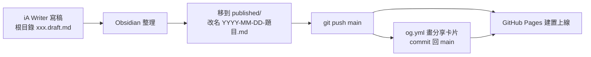
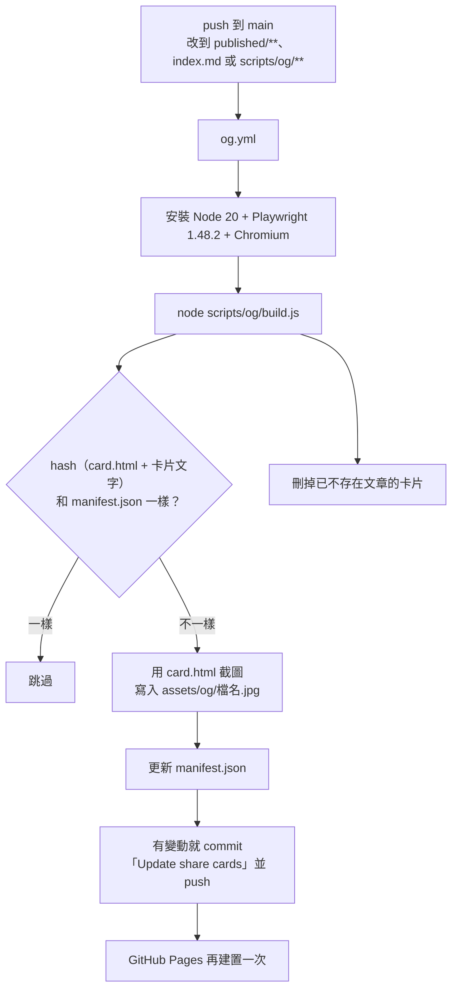
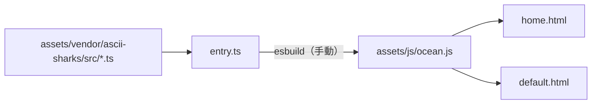

# laiyenju.github.io

Yen Lai 的個人網站：<https://laiyenju.github.io>

- 純 Jekyll，由 GitHub Pages 建置（`main` 分支、根目錄）。沒有主題，沒有外掛，沒有 `Gemfile`。
- 只有兩個自動流程：**GitHub Pages 建置網站**、**GitHub Action 畫分享卡片**。
- 只有一個手動步驟：改了錦鯉原始碼（`assets/vendor/ascii-sharks/src/`）之後，要重新打包 `assets/js/ocean.js`。

---

## 1. 資料夾結構

```text
.
├── _config.yml              網站設定：網址、作者、語言、哪些檔案要建置 / 排除
├── index.md                 首頁（layout: home）；首頁同時是 notes / works 的畫面
├── published/               已發布的文章 ── 放進這裡 = 發布
│   └── YYYY-MM-DD-題目.md
├── *.draft.md               草稿（放在根目錄，_config.yml 排除，不會上線）
├── notes/index.md           /notes/ → 轉址到 /?view=notes（保留舊網址用）
├── works/index.md           /works/ → 轉址到 /?view=works
├── sitemap.xml              Liquid 產生：首頁 + published/ 的文章
├── robots.txt               Liquid 產生：指向 sitemap.xml
│
├── _layouts/
│   ├── home.html            首頁：自我介紹、notes 清單、works 清單、日夜開關、錦鯉
│   └── default.html         文章頁（published/ 的文章都用它）
├── _includes/
│   ├── head.html            <head> 共用內容：meta、<title>、seo.html、字型、site.css
│   ├── seo.html             canonical、description、Open Graph / Twitter、JSON-LD、favicon
│   └── theme-boot.html      畫面出現前執行：決定日夜主題與介面語言（避免閃爍）
├── _data/
│   └── works.yml            works 清單資料（title / one_liner / status / url），目前是 []
│
├── assets/
│   ├── css/site.css         全站唯一的樣式表（顏色 token 註解在檔案開頭）
│   ├── js/
│   │   ├── theme.js         日夜切換（auto / day / night），存在 localStorage
│   │   ├── ocean.js         錦鯉引擎的打包結果（⚠ 由 esbuild 產生，不要手改）
│   │   ├── home.js          首頁 home ↔ notes ↔ works 的切換動畫
│   │   ├── shell.js         notes / works 的 terminal 介面、指令、點文章時的 cat 轉場
│   │   └── post.js          文章頁：打字效果、側欄註腳、結尾提示字元、(END) 錦鯉
│   ├── vendor/ascii-sharks/ 錦鯉引擎 TypeScript 原始碼（Jekyll 排除，不會上線）
│   │   ├── entry.ts         打包入口：把 OceanEngine、OceanThemes 掛到 window
│   │   └── src/             engine / world / renderer / species / themes / math
│   ├── og/                  分享卡片 1200×630 JPG（由 Action 產生）
│   │   ├── home.jpg         首頁卡片，也是新文章卡片產生前的備用圖
│   │   ├── <文章檔名>.jpg
│   │   └── manifest.json    每張卡片的 hash，用來判斷要不要重畫（不會上線）
│   ├── icons/               favicon.svg、favicon-32.png、apple-touch-icon.png（朱色印章）
│   ├── fonts/quattro/       iA Writer Quattro（文章內文字型）+ 授權
│   └── images/              文章用的圖片
│
├── scripts/og/              （Jekyll 排除）
│   ├── build.js             用 Playwright 把 card.html 截圖成每篇文章的卡片
│   └── card.html            卡片的版型
└── .github/workflows/og.yml 分享卡片的 GitHub Action
```

### 頁面用到哪些檔案

| 頁面 | Layout | Include | JS（依載入順序） |
|------|--------|---------|------------------|
| 首頁 `/`（含 `?view=notes`、`?view=works`） | `home.html` | `head.html`（含 `seo.html`）、`theme-boot.html` | `theme.js` → `ocean.js` → `home.js` → `shell.js` |
| 文章 `/published/*.html` | `default.html` | `head.html`（含 `seo.html`）、`theme-boot.html` | `theme.js` → `ocean.js` → `post.js` |

外部資源只有 Google Fonts：JetBrains Mono、Noto Sans TC；錦鯉用的 Noto Serif TC、DotGothic16 用 `text=` 參數只下載字根。

---

## 2. 流程

### 2.1 寫作與發布



1. 草稿放在根目錄，檔名結尾是 `.draft.md`，不會上線。
2. 發布 = 把檔案移進 `published/`，檔名用 `YYYY-MM-DD-題目.md`。
3. Front matter：

   ```yaml
   ---
   title: 文章標題        # 必填
   date: 2026-10-29       # 必填，排序、sitemap、卡片都用它
   description: 一句話    # 選填；沒寫就取內文前 120 字
   ---
   ```

   `layout` 不用寫（`_config.yml` 預設 `default`）。`status` 只是給自己看的標記，程式不讀它。
4. `git push` 到 `main`，其他都是自動的。

文章網址的規則：`published/2026-10-29-markdown-styles.md` → `/published/2026-10-29-markdown-styles.html`。notes 清單上顯示的檔名會去掉日期（`markdown-styles.md`）。

### 2.2 分享卡片（自動）



- 卡片文字和 `seo.html` 的 description 規則一致：front matter 的 `description`，沒有就取內文前 120 字。兩邊的規則改了要一起改。
- 改了 `card.html`，所有卡片都會重畫。
- 新文章的卡片還沒產生前，`seo.html` 會先用 `home.jpg`。
- 也可以在 GitHub → Actions → Share cards → **Run workflow** 手動執行。
- 本機執行：

  ```bash
  npm install --no-save playwright && npx playwright install chromium && node scripts/og/build.js
  ```

### 2.3 錦鯉引擎（手動打包）



改了 `src/` 或 `entry.ts` 之後，執行下面的指令，再把 `ocean.js` 一起 commit：

```bash
npx esbuild@0.24.0 assets/vendor/ascii-sharks/entry.ts --bundle --format=iife --target=es2019 --outfile=assets/js/ocean.js
```

- 字元和配色在 `src/themes.ts`：`GLYPH_DAY`（日間，明體倉頡字根）、`GLYPH_NIGHT`（夜間，點陣字根、琥珀色）、`ASCII`（原版）。
- 改了 `themes.ts` 的 `RADICALS`，也要更新 `head.html` 裡 Google Fonts 的 `text=` 清單。

### 2.4 本機預覽

```bash
jekyll serve
```

輸出在 `_site/`（已在 `.gitignore`）。

---

## 3. 檔案檢查結果（2026-10-31）

`ocean.js` 已確認和 `src/` 重新打包的結果相同。

已處理：

- `default.html` 改用 `_includes/head.html`，字型和 `site.css` 只寫在一個地方。`<title>`：首頁顯示自己的 `title`，其他頁是「標題 · Yen Lai」。
- `head.html` 不再用不存在的 `site.author.greeting`。
- `_config.yml` 刪掉重複的 `defaults`；`hello.md` 刪掉多餘的 `layout: default`。

還沒處理：

| # | 項目 | 狀況 | 建議 |
|---|------|------|------|
| 1 | `published/2026-03-08-hello.md` | 範例文章，已公開上線、在 sitemap 裡 | 第一篇正式文章上線後刪除 |
| 2 | `published/2026-10-29-markdown-styles.md` + `assets/images/markdown-sample.svg` | 樣式測試頁，也公開上線 | 想保留當測試頁，可移到根目錄改成 `.draft.md`（但本機預覽就看不到）；或加 front matter `sitemap: false`，並在 `sitemap.xml`、首頁 notes 清單加條件排除 |
| 3 | `sample.draft.md` | 草稿範例，不會上線 | 不再需要就刪除 |
| 4 | Front matter 的 `status` | 沒有任何程式讀它 | 可以不寫 |
| 5 | `_config.yml` 的 `exclude` | `Gemfile`、`Gemfile.lock`、`vendor` 在 repo 裡不存在 | 無害；要精簡可以刪 |

---

## 4. 設計規則（改樣式前先看）

- **顏色**：每個顏色只代表一件事（`site.css` 開頭有註解）。
  - 墨：要讀的東西（標題、內文、清單、內文連結加虛線）。
  - 強調色（日間朱 `#b5531e`、夜間琥珀 `#f5b942`）：可以操作的地方，或正在進行的事。只當記號，字本身保持墨色。
  - 灰：說明或離開（日期、字數、`cd ~`、外部連結 `↗`）。
- **反白（實心）**：只代表「目前選中」。terminal 的列（清單、`$ cd ~`、`$ cd ..`、上一篇／下一篇）hover 時整列反白；一般連結只變深色。
- **標題**：文章的所有標題和內文同樣大小，只用粗體，層次靠留白。
- **註腳**：視窗 ≥ 1088px 放右側欄，較窄時放文末（`post.js` 的 `RAIL_MIN`）。
- **works 狀態**：`in progress` ●（強調色）、`experiment` ◐、其他 ○。
- **介面語言**：瀏覽器第一語言是中文就顯示中文，其他顯示英文（`theme-boot.html` 加上 `ui-zh` class）。
  - HTML：`<span class="i-en">` / `<span class="i-zh">` 各寫一份。
  - JS：`t("English", "中文")`。
  - `aria-label` / `title`：預設英文，中文寫在 `data-label-zh` / `data-title-zh`。
- **瀏覽器儲存**：`localStorage.theme`（日夜選擇）、`sessionStorage.post-handoff`（從 notes 點文章時，讓文章頁知道不要再打字一次）。
- **觸控螢幕**：不顯示輸入框，改用指令按鈕（notes／works：`help` `whoami` `theme` `cd ~`；文章：`help` `top` `cd ..` `theme`）。
